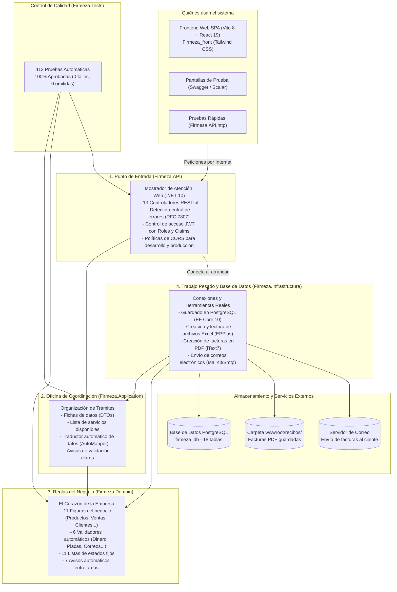

# Firmeza - Sistema de Gestión Comercial, Logística y Alquiler de Maquinaria

[](https://dotnet.microsoft.com/)
[](https://docs.microsoft.com/dotnet/csharp/)
[](https://www.postgresql.org/)
[](https://dotnet.microsoft.com/)
[](tests/Firmeza.Tests)
[](../../Firmeza.app/Firmeza_front)
[](http://localhost:5125/swagger)

**Firmeza** es una plataforma completa para administrar ferreterías mayoristas y empresas de materiales de construcción. Permite llevar el control del inventario de materiales, registrar ventas con cálculo automático del IVA (19%), generar facturas en PDF, enviar recibos por correo electrónico, programar despachos de materiales hacia las obras y administrar el alquiler de volquetas y maquinaria pesada.

Está construido en **.NET 10 (C# 13)** y **PostgreSQL**, organizado en **4 capas independientes** para que el código sea ordenado, seguro y muy fácil de entender y mantener.

---

## 🏛️ Cómo está Organizado el Sistema (Vista General)

Imagina el sistema como una **gran empresa ferretera y de maquinaria** donde cada área tiene su propia responsabilidad y trabaja en equipo sin desorden:



---

## 🗂️ Estructura Completa de Carpetas y Archivos

```text
Firmeza/
├── database/                                     # Scripts SQL para crear y llenar la base de datos (18 tablas)
│   ├── migrations/
│   │   └── 01_consolidate_categories.sql         # Limpieza y organización de las 20 categorías del catálogo
│   ├── schema.sql                                # Crea todas las tablas y relaciones desde cero
│   └── seed_data.sql                             # Inserta usuarios, roles, clientes, productos y vehículos de prueba
│
├── src/                                          # Código principal dividido en 4 proyectos
│   ├── Firmeza.Domain/                           # 🟡 1. Reglas del Negocio (No depende de librerías externas)
│   │   ├── Abstractions/                         # 15 acuerdos de qué tareas deben existir para guardar datos
│   │   ├── Common/                               # 3 moldes base para compartir funciones comunes
│   │   ├── Entities/                             # 11 elementos principales (Producto, Venta, Cliente, Vehículo...)
│   │   ├── Enums/                                # 11 listas de opciones fijas (estados de ventas, envíos, pagos...)
│   │   ├── Errors/                               # 2 archivos con el catálogo de mensajes de error claros
│   │   ├── Events/                               # 7 avisos automáticos cuando ocurre algo importante
│   │   ├── Exceptions/                           # 4 frenos de seguridad si alguien intenta romper una regla
│   │   ├── ValueObjects/                         # 6 validadores de datos (Dinero, Placa, NIT, Correo, Teléfono, SKU)
│   │   └── Firmeza.Domain.csproj
│   │
│   ├── Firmeza.Application/                      # 🔵 2. Coordinación y Formularios de Datos
│   │   ├── DTOs/                                 # 8 archivos con fichas de datos para enviar y recibir información
│   │   ├── Exceptions/                           # 4 tipos de avisos cuando un trámite no se puede realizar
│   │   ├── Interfaces/                           # 8 listas de tareas de los servicios principales
│   │   ├── Mappings/                             # 1 traductor automático entre la base de datos y las fichas (MappingProfile)
│   │   ├── DependencyInjection.cs                # Conecta las herramientas de esta capa al encender el sistema
│   │   └── Firmeza.Application.csproj
│   │
│   ├── Firmeza.Infrastructure/                   # 🟣 3. Base de Datos y Herramientas Prácticas
│   │   ├── Persistence/                          # Conexión y manejo de la base de datos PostgreSQL
│   │   │   ├── Configurations/                   # 11 planos que indican cómo guardar cada tabla en PostgreSQL
│   │   │   ├── Interceptors/                     # 2 asistentes automáticos (fechas de registro y envío de avisos)
│   │   │   ├── Migrations/                       # Historial de creación de tablas para Entity Framework
│   │   │   ├── Repositories/                     # 11 encargados de buscar, guardar y borrar datos en las tablas
│   │   │   ├── Seeders/                          # 2 archivos que cargan los datos iniciales al arrancar por primera vez
│   │   │   ├── ApplicationDbContext.cs           # Puente principal con las 18 tablas de la base de datos
│   │   │   └── AppDbContext.cs                   # Acceso directo al puente de base de datos
│   │   ├── Services/                             # 10 servicios prácticos (Ventas, Productos, Clientes, Excel, PDF, Correo...)
│   │   ├── DependencyInjection.cs                # Conecta la base de datos y los servicios al iniciar el programa
│   │   └── Firmeza.Infrastructure.csproj
│   │
│   └── Firmeza.API/                              # 🔴 4. Punto de Entrada Web (Mostrador de Atención)
│       ├── Controllers/                          # 13 ventanillas web para atender cada tema del negocio
│       ├── Middleware/                           # 1 detector central que convierte fallos en mensajes claros
│       ├── Properties/                           # Configuración de puertos para abrir el sistema (5125 y 7049)
│       ├── wwwroot/recibos/                      # Carpeta donde se guardan las facturas en PDF
│       ├── appsettings.json                      # Datos de conexión a PostgreSQL, llaves de seguridad y correo
│       ├── appsettings.Development.json          # Ajustes para trabajar en modo de pruebas locales
│       ├── Program.cs                            # Archivo principal que enciende y configura todo el servidor web
│       ├── Firmeza.API.http                      # Colección de pruebas rápidas listas para usar con un clic
│       └── Firmeza.API.csproj
│
├── tests/                                        # 🟢 5. Pruebas Automáticas de Calidad
│   └── Firmeza.Tests/                            # 15 archivos con 112 pruebas unitarias y de integración que verifican todo el sistema
│
├── Firmeza.sln                                   # Archivo que une los 5 proyectos de la solución
└── README.md                                     # Esta guía explicativa del proyecto
```

---

## 📂 Guía Paso a Paso de Cada Archivo (En Lenguaje Sencillo)

Todos los archivos del proyecto tienen comentarios internos breves y claros con `//` (sin etiquetas complicadas ni palabras técnicas innecesarias). Aquí tienes el resumen de qué hace cada archivo:

### 1. 🟡 Capa de Reglas del Negocio (`src/Firmeza.Domain`)

Es el corazón del sistema. Contiene las normas básicas de la ferretería: por ejemplo, que no se puede vender más material del que hay en bodega, que ningún precio puede ser menor a cero y que un camión alquilado no puede entregarse a dos clientes al mismo tiempo.

#### 📁 `Entities/` (Los Elementos Reales de la Ferretería)
* [`Producto.cs`](src/Firmeza.Domain/Entities/Producto.cs): Representa cada artículo o material de construcción. Guarda su código, nombre, precio y cantidad disponible. Incluye funciones para descontar o sumar unidades y avisa cuando quedan 10 unidades o menos.
* [`Venta.cs`](src/Firmeza.Domain/Entities/Venta.cs): Representa la factura de una compra. Suma los productos, calcula el IVA del 19% y el total a pagar. Si se anula la venta, marca el estado como anulado para devolver los productos a la bodega.
* [`DetalleVenta.cs`](src/Firmeza.Domain/Entities/DetalleVenta.cs): Representa cada renglón dentro de una factura (qué producto se llevó, cuántas unidades y a qué precio se vendió ese día).
* [`Cliente.cs`](src/Firmeza.Domain/Entities/Cliente.cs): Guarda los datos del comprador (documento, nombres, correo, teléfono, dirección y fecha de nacimiento) y calcula su edad automáticamente.
* [`Categoria.cs`](src/Firmeza.Domain/Entities/Categoria.cs): Clasifica los productos por familias (como Cementos, Herramientas, Tuberías o Maquinaria Pesada) para mantener el catálogo ordenado.
* [`Proveedor.cs`](src/Firmeza.Domain/Entities/Proveedor.cs): Guarda la información de las fábricas y distribuidores que surten la ferretería (NIT, razón social, contacto y ciudad).
* [`MetodoPago.cs`](src/Firmeza.Domain/Entities/MetodoPago.cs): Registra las formas de pago aceptadas (Efectivo, Transferencia, Tarjeta o Crédito a 30 días).
* [`Vehiculo.cs`](src/Firmeza.Domain/Entities/Vehiculo.cs): Representa los camiones, volquetas y máquinas de construcción de la empresa, con su placa, capacidad en toneladas, costo por día y si están libres o en uso.
* [`Alquiler.cs`](src/Firmeza.Domain/Entities/Alquiler.cs): Es el contrato cuando un cliente alquila una máquina o vehículo por varios días. Calcula el total según los días de uso y cambia el estado del vehículo.
* [`Despacho.cs`](src/Firmeza.Domain/Entities/Despacho.cs): Controla el envío de materiales a la obra del cliente: dirección de entrega, costo del transporte y si el pedido está pendiente, en camino o entregado.
* [`MovimientoInventario.cs`](src/Firmeza.Domain/Entities/MovimientoInventario.cs): Es el historial de bodega. Anota cada vez que entra o sale mercancía, cuánto había antes, cuánto quedó después y el motivo.

#### 📁 `ValueObjects/` (Validadores Automáticos de Datos)
Revisan que los datos importantes estén bien escritos antes de aceptarlos:
* [`Dinero.cs`](src/Firmeza.Domain/ValueObjects/Dinero.cs): Maneja valores en pesos colombianos, redondea a dos decimales e impide cantidades negativas.
* [`CodigoSku.cs`](src/Firmeza.Domain/ValueObjects/CodigoSku.cs): Limpia el código del producto y lo pasa a mayúsculas (como `PROD-001`).
* [`Placa.cs`](src/Firmeza.Domain/ValueObjects/Placa.cs): Verifica que la placa de un vehículo tenga el formato válido (como `WXC-456`).
* [`Nit.cs`](src/Firmeza.Domain/ValueObjects/Nit.cs): Revisa que el documento o NIT tenga números válidos y calcula su dígito de verificación.
* [`Email.cs`](src/Firmeza.Domain/ValueObjects/Email.cs): Comprueba que el correo electrónico tenga un formato real con `@` y dominio.
* [`Telefono.cs`](src/Firmeza.Domain/ValueObjects/Telefono.cs): Verifica que el teléfono tenga entre 7 y 15 dígitos válidos.

#### 📁 `Enums/` (Listas de Opciones Fijas)
Evitan errores de escritura definiendo opciones claras para todo el sistema:
* [`EstadoVenta.cs`](src/Firmeza.Domain/Enums/EstadoVenta.cs): `Pendiente`, `Completada`, `Anulada`.
* [`EstadoDespacho.cs`](src/Firmeza.Domain/Enums/EstadoDespacho.cs): `Pendiente`, `EnRuta`, `Entregado`, `Cancelado`.
* [`EstadoVehiculo.cs`](src/Firmeza.Domain/Enums/EstadoVehiculo.cs): `Disponible`, `Alquilado`, `EnMantenimiento`.
* [`EstadoAlquiler.cs`](src/Firmeza.Domain/Enums/EstadoAlquiler.cs): `Activo`, `Finalizado`, `Cancelado`.
* [`TipoMovimientoInventario.cs`](src/Firmeza.Domain/Enums/TipoMovimientoInventario.cs): `Entrada`, `Salida`, `Ajuste`.
* [`TipoVehiculo.cs`](src/Firmeza.Domain/Enums/TipoVehiculo.cs): Tipos de vehículos y maquinaria de la flota.
* [`TipoMetodoPago.cs`](src/Firmeza.Domain/Enums/TipoMetodoPago.cs): Formas de pago disponibles.
* [`TipoIdentificacion.cs`](src/Firmeza.Domain/Enums/TipoIdentificacion.cs): Tipos de documento (Cédula, NIT, Pasaporte, etc.).
* [`UnidadMedida.cs`](src/Firmeza.Domain/Enums/UnidadMedida.cs): Cómo se mide cada material (Unidad, Bulto, Kilo, Metro, Galón, Tonelada).
* [`PrioridadDespacho.cs`](src/Firmeza.Domain/Enums/PrioridadDespacho.cs): Nivel de urgencia de un envío (`Baja`, `Normal`, `Alta`, `Urgente`).
* [`EstadoCotizacion.cs`](src/Firmeza.Domain/Enums/EstadoCotizacion.cs): Estados de una cotización (`Borrador`, `Enviada`, `Aprobada`, `Rechazada`, `Vencida`).

#### 📁 `Events/` (Avisos Automáticos Internos)
* [`VentaRegistradaDomainEvent.cs`](src/Firmeza.Domain/Events/VentaRegistradaDomainEvent.cs) y [`VentaCanceladaDomainEvent.cs`](src/Firmeza.Domain/Events/VentaCanceladaDomainEvent.cs): Avisan cuando se realiza o se anula una venta.
* [`StockBajoDomainEvent.cs`](src/Firmeza.Domain/Events/StockBajoDomainEvent.cs): Avisa cuando un producto queda con 10 unidades o menos.
* [`VehiculoAlquiladoDomainEvent.cs`](src/Firmeza.Domain/Events/VehiculoAlquiladoDomainEvent.cs) y [`VehiculoLiberadoDomainEvent.cs`](src/Firmeza.Domain/Events/VehiculoLiberadoDomainEvent.cs): Avisan cuando una máquina se ocupa o vuelve a quedar libre.
* [`DespachoEnRutaDomainEvent.cs`](src/Firmeza.Domain/Events/DespachoEnRutaDomainEvent.cs) y [`DespachoEntregadoDomainEvent.cs`](src/Firmeza.Domain/Events/DespachoEntregadoDomainEvent.cs): Avisan cuando un pedido sale hacia la obra o cuando ya fue entregado.

#### 📁 `Exceptions/`, `Errors/`, `Common/` y `Abstractions/`
* **Frenos de seguridad (`Exceptions/`):** [`DomainException.cs`](src/Firmeza.Domain/Exceptions/DomainException.cs), [`StockInsuficienteException.cs`](src/Firmeza.Domain/Exceptions/StockInsuficienteException.cs), [`ReglaNegocioException.cs`](src/Firmeza.Domain/Exceptions/ReglaNegocioException.cs) y [`ValorInvalidoException.cs`](src/Firmeza.Domain/Exceptions/ValorInvalidoException.cs) detienen cualquier operación si faltan unidades en bodega o si hay datos incorrectos.
* **Catálogo de errores (`Errors/`):** [`DomainError.cs`](src/Firmeza.Domain/Errors/DomainError.cs) y [`DomainErrors.cs`](src/Firmeza.Domain/Errors/DomainErrors.cs) reúnen los mensajes de error en un solo lugar.
* **Moldes base (`Common/`):** [`AggregateRoot.cs`](src/Firmeza.Domain/Common/AggregateRoot.cs), [`ValueObject.cs`](src/Firmeza.Domain/Common/ValueObject.cs) e [`IDomainEvent.cs`](src/Firmeza.Domain/Common/IDomainEvent.cs) dan funciones comunes a las clases del negocio.
* **Acuerdos de búsqueda y guardado (`Abstractions/`):** 15 interfaces ([`IRepository.cs`](src/Firmeza.Domain/Abstractions/IRepository.cs), [`IUnitOfWork.cs`](src/Firmeza.Domain/Abstractions/IUnitOfWork.cs), [`IProductoRepository.cs`](src/Firmeza.Domain/Abstractions/IProductoRepository.cs), [`IVentaRepository.cs`](src/Firmeza.Domain/Abstractions/IVentaRepository.cs), etc.) que indican cómo consultar y guardar cada tipo de información.

---

### 2. 🔵 Capa de Coordinación (`src/Firmeza.Application`)

Organiza los formularios de entrada y salida y define las tareas que la aplicación ofrece.

* **Formularios de datos (`DTOs/`):**
  * [`AuthDto.cs`](src/Firmeza.Application/DTOs/AuthDto.cs): Datos para iniciar sesión, registrar cuentas y entregar la llave de acceso.
  * [`ProductoDto.cs`](src/Firmeza.Application/DTOs/ProductoDto.cs): Datos para mostrar, crear o editar un producto.
  * [`CategoriaDto.cs`](src/Firmeza.Application/DTOs/CategoriaDto.cs): Datos de cada categoría junto con el total de productos que tiene.
  * [`ClienteDto.cs`](src/Firmeza.Application/DTOs/ClienteDto.cs): Datos del cliente listos para mostrarse en pantalla.
  * [`VentaDto.cs`](src/Firmeza.Application/DTOs/VentaDto.cs): Datos de una factura de venta y su lista de productos comprados.
  * [`CommercialDtos.cs`](src/Firmeza.Application/DTOs/CommercialDtos.cs): Fichas de datos para proveedores, métodos de pago, vehículos, alquileres, despachos y movimientos de bodega.
  * [`DashboardDto.cs`](src/Firmeza.Application/DTOs/DashboardDto.cs): Resumen con las cifras generales del negocio (ventas del día, ingresos totales, productos más vendidos).
  * [`ExcelDto.cs`](src/Firmeza.Application/DTOs/ExcelDto.cs): Estructura de filas y resultados al subir o descargar archivos de Excel.
* **Avisos de rechazo (`Exceptions/`):** [`NotFoundException.cs`](src/Firmeza.Application/Exceptions/NotFoundException.cs) (cuando algo no existe), [`ConflictException.cs`](src/Firmeza.Application/Exceptions/ConflictException.cs) (cuando un dato ya está repetido), [`ValidationException.cs`](src/Firmeza.Application/Exceptions/ValidationException.cs) (datos mal llenados) y [`ForbiddenAccessException.cs`](src/Firmeza.Application/Exceptions/ForbiddenAccessException.cs) (falta de permisos).
* **Acuerdos de servicio (`Interfaces/`):** Define qué hacen los servicios de clientes ([`IClienteService.cs`](src/Firmeza.Application/Interfaces/IClienteService.cs)), productos ([`IProductoService.cs`](src/Firmeza.Application/Interfaces/IProductoService.cs)), ventas ([`IVentaService.cs`](src/Firmeza.Application/Interfaces/IVentaService.cs)), panel de resumen ([`IDashboardService.cs`](src/Firmeza.Application/Interfaces/IDashboardService.cs)), Excel ([`IExcelService.cs`](src/Firmeza.Application/Interfaces/IExcelService.cs)), PDF ([`IPdfService.cs`](src/Firmeza.Application/Interfaces/IPdfService.cs)), correo ([`IEmailService.cs`](src/Firmeza.Application/Interfaces/IEmailService.cs)) y llaves de acceso ([`IJwtTokenService.cs`](src/Firmeza.Application/Interfaces/IJwtTokenService.cs)).
* **Traductor y conexión:** [`MappingProfile.cs`](src/Firmeza.Application/Mappings/MappingProfile.cs) pasa los datos automáticamente de las tablas a las fichas, y [`DependencyInjection.cs`](src/Firmeza.Application/DependencyInjection.cs) deja listo el traductor al arrancar.

---

### 3. 🟣 Capa de Base de Datos y Herramientas (`src/Firmeza.Infrastructure`)

Hace el trabajo práctico: se comunica con PostgreSQL, genera archivos PDF y Excel, y envía correos electrónicos.

* **Conexión a PostgreSQL (`Persistence/`):**
  * [`ApplicationDbContext.cs`](src/Firmeza.Infrastructure/Persistence/ApplicationDbContext.cs) y [`AppDbContext.cs`](src/Firmeza.Infrastructure/Persistence/AppDbContext.cs): Conectan el programa con las 18 tablas de la base de datos.
  * **`Configurations/` (11 archivos):** Indican el nombre de cada tabla, las columnas obligatorias y que no se repitan códigos, cédulas ni placas.
  * **`Interceptors/` (2 archivos):** [`AuditableEntityInterceptor.cs`](src/Firmeza.Infrastructure/Persistence/Interceptors/AuditableEntityInterceptor.cs) pone automáticamente la fecha de creación a los registros nuevos, y [`DispatchDomainEventsInterceptor.cs`](src/Firmeza.Infrastructure/Persistence/Interceptors/DispatchDomainEventsInterceptor.cs) envía los avisos internos cuando se guarda un cambio.
  * **`Repositories/` (11 archivos):** Encargados de consultar y guardar en cada tabla de PostgreSQL, apoyados por [`UnitOfWork.cs`](src/Firmeza.Infrastructure/Persistence/Repositories/UnitOfWork.cs) para que todos los pasos de una operación se guarden juntos sin errores.
  * **`Seeders/` (2 archivos):** [`DbSeeder.cs`](src/Firmeza.Infrastructure/Persistence/Seeders/DbSeeder.cs) e [`IDbSeeder.cs`](src/Firmeza.Infrastructure/Persistence/Seeders/IDbSeeder.cs) crean automáticamente los roles, el usuario administrador y los medios de pago si la base de datos está vacía.
  * **`Migrations/`:** [`20261021233728_InitialCreate.cs`](src/Firmeza.Infrastructure/Persistence/Migrations/20261021233728_InitialCreate.cs) contiene las instrucciones para crear las 18 tablas desde el código.
* **Servicios Prácticos (`Services/` - 10 archivos):**
  * [`VentaService.cs`](src/Firmeza.Infrastructure/Services/VentaService.cs): Registra compras verificando el cliente y el stock, calcula el 19% de IVA, descuenta unidades, anota la salida en el historial de bodega y permite anular ventas devolviendo el material.
  * [`ProductoService.cs`](src/Firmeza.Infrastructure/Services/ProductoService.cs): Crea, actualiza, consulta y elimina productos (si el producto ya tiene ventas, solo lo desactiva para no perder el historial).
  * [`ClienteService.cs`](src/Firmeza.Infrastructure/Services/ClienteService.cs): Registra y actualiza clientes verificando que no se repitan la cédula ni el correo.
  * [`DashboardService.cs`](src/Firmeza.Infrastructure/Services/DashboardService.cs): Calcula los totales de ventas, ingresos, alertas de inventario y los 5 productos más vendidos.
  * [`ExcelService.cs`](src/Firmeza.Infrastructure/Services/ExcelService.cs): Crea plantillas de Excel, exporta el catálogo o las ventas y permite cargar cientos de productos y clientes desde un archivo `.xlsx`.
  * [`PdfService.cs`](src/Firmeza.Infrastructure/Services/PdfService.cs): Diseña y genera el archivo PDF de cada factura de venta con el detalle de productos e impuestos.
  * [`EmailService.cs`](src/Firmeza.Infrastructure/Services/EmailService.cs): Envía correos de bienvenida y facturas en PDF a los clientes.
  * [`JwtTokenService.cs`](src/Firmeza.Infrastructure/Services/JwtTokenService.cs): Crea la llave digital de sesión cuando un usuario entra con su contraseña.
  * [`DomainEventDispatcher.cs`](src/Firmeza.Infrastructure/Services/DomainEventDispatcher.cs): Reparte los avisos internos a las tareas encargadas de atenderlos.
  * [`SystemDateTimeProvider.cs`](src/Firmeza.Infrastructure/Services/SystemDateTimeProvider.cs): Entrega la fecha y hora actual del sistema.

---

### 4. 🔴 Capa de Entrada Web (`src/Firmeza.API`)

Es el mostrador de atención por internet. Recibe las solicitudes, verifica permisos y devuelve las respuestas.

* **Ventanillas de atención (`Controllers/` - 13 archivos):**
  * [`AuthController.cs`](src/Firmeza.API/Controllers/AuthController.cs): Inicio de sesión (`/api/Auth/login`) y registro de nuevos usuarios (`/api/Auth/register`).
  * [`ProductsController.cs`](src/Firmeza.API/Controllers/ProductsController.cs): Consulta de productos, creación, edición y carga/descarga de archivos Excel (`/api/Products`).
  * [`CategoriesController.cs`](src/Firmeza.API/Controllers/CategoriesController.cs): Administración de las 20 categorías del catálogo (`/api/Categories`).
  * [`ClientsController.cs`](src/Firmeza.API/Controllers/ClientsController.cs): Gestión de la cartera de clientes (`/api/Clients`).
  * [`SalesController.cs`](src/Firmeza.API/Controllers/SalesController.cs): Registro de ventas, anulación, descarga de facturas PDF y reporte en Excel (`/api/Sales`).
  * [`DashboardController.cs`](src/Firmeza.API/Controllers/DashboardController.cs): Resumen de estadísticas del negocio (`/api/Dashboard`).
  * [`DispatchesController.cs`](src/Firmeza.API/Controllers/DispatchesController.cs): Programación y seguimiento de envíos de material a las obras (`/api/Dispatches`).
  * [`VehiclesController.cs`](src/Firmeza.API/Controllers/VehiclesController.cs): Catálogo de volquetas, camiones y maquinaria pesada (`/api/Vehicles`).
  * [`RentalsController.cs`](src/Firmeza.API/Controllers/RentalsController.cs): Creación y cierre de contratos de alquiler de maquinaria (`/api/Rentals`).
  * [`InventoryMovementsController.cs`](src/Firmeza.API/Controllers/InventoryMovementsController.cs): Consulta y registro de entradas y salidas de bodega (`/api/InventoryMovements`).
  * [`SuppliersController.cs`](src/Firmeza.API/Controllers/SuppliersController.cs): Gestión de empresas proveedoras (`/api/Suppliers`).
  * [`PaymentMethodsController.cs`](src/Firmeza.API/Controllers/PaymentMethodsController.cs): Consulta y registro de medios de pago (`/api/PaymentMethods`).
  * [`UsersController.cs`](src/Firmeza.API/Controllers/UsersController.cs): Consulta de usuarios del sistema y sus roles (`/api/Users`).
* **Archivos principales:**
  * [`GlobalExceptionHandlerMiddleware.cs`](src/Firmeza.API/Middleware/GlobalExceptionHandlerMiddleware.cs): Atrapa cualquier problema inesperado y devuelve un mensaje claro y ordenado sin que el servidor se detenga.
  * [`Program.cs`](src/Firmeza.API/Program.cs): Enciende el servidor, conecta la base de datos, activa la seguridad y publica las pantallas de documentación interactiva (**Swagger** y **Scalar**).
  * [`Firmeza.API.http`](src/Firmeza.API/Firmeza.API.http): Archivo con peticiones listas para probar cada ruta con un solo clic desde el editor de código.

---

### 5. 🟢 Capa de Pruebas Automáticas (`tests/Firmeza.Tests`)

Contiene **15 archivos con 112 pruebas automáticas** que comprueban que todas las partes del sistema funcionen con cero fallos (100% aprobadas):
* **Validación de Objetos de Valor DDD (20 pruebas):** Comprueban que los precios, placas vehiculares, correos, teléfonos, NITs con dígito de verificación y códigos SKU rechacen datos mal escritos e impidan operaciones inválidas ([`DomainDddTests.cs`](tests/Firmeza.Tests/DomainDddTests.cs)).
* **Entidades y Reglas de Negocio Centrales (14 pruebas):** Prueban el ciclo de vida de productos, cálculo automático del IVA del 19% en ventas, límites de descuento, cálculo de edad de clientes y validaciones de stock ([`DomainEntityTests.cs`](tests/Firmeza.Tests/DomainEntityTests.cs)).
* **Dominio Comercial y Logística (12 pruebas):** Prueban el ciclo de alquiler de maquinaria pesada, cambio de disponibilidad de volquetas, despacho a pie de obra con cambio de estados y kardex de inventario ([`CommercialDomainTests.cs`](tests/Firmeza.Tests/CommercialDomainTests.cs)).
* **Servicios de Ventas y Facturación (18 pruebas):** Prueban la creación de facturas con validación de stock atómica, registro de movimientos de salida en bodega y anulación con reintegro automático de mercancía ([`VentaServiceTests.cs`](tests/Firmeza.Tests/VentaServiceTests.cs), [`SalesControllerTests.cs`](tests/Firmeza.Tests/SalesControllerTests.cs)).
* **Gestión de Catálogo y Cartera (21 pruebas):** Prueban la creación, actualización y baja lógica de productos y clientes evitando duplicación de cédulas o códigos ([`ProductoServiceTests.cs`](tests/Firmeza.Tests/ProductoServiceTests.cs), [`ClienteServiceTests.cs`](tests/Firmeza.Tests/ClienteServiceTests.cs)).
* **Importación Masiva y Reportes Excel (10 pruebas):** Prueban la generación y lectura de archivos `.xlsx` desnormalizados con EPPlus para productos y clientes ([`DesnormalizedExcelTests.cs`](tests/Firmeza.Tests/DesnormalizedExcelTests.cs)).
* **Infraestructura y Manejador Global de Errores (17 pruebas):** Prueban la generación de PDFs con iText7, envío de correos vía MailKit y el middleware RFC 7807 que intercepta excepciones sin tumbar el servidor ([`EmailServiceTests.cs`](tests/Firmeza.Tests/EmailServiceTests.cs), [`GlobalExceptionHandlerMiddlewareTests.cs`](tests/Firmeza.Tests/GlobalExceptionHandlerMiddlewareTests.cs)).

---

### 6. 🗃️ Base de Datos (`database/`)

La base de datos PostgreSQL (`firmeza_db`) cuenta con **18 tablas** (7 para el control de usuarios y roles + 11 para la operación comercial de la ferretería):

* [`schema.sql`](database/schema.sql): Crea las 18 tablas con sus relaciones y carga las 20 categorías oficiales del catálogo.
* [`seed_data.sql`](database/seed_data.sql): Llena la base de datos con usuarios de prueba, roles de trabajo, clientes, proveedores, materiales de construcción, vehículos y ventas de ejemplo.
* [`migrations/01_consolidate_categories.sql`](database/migrations/01_consolidate_categories.sql): Limpia categorías repetidas y organiza los productos en las 20 familias principales.

---

### 7. 🌐 Integración con el Frontend Web SPA (`Firmeza_front`)

El backend expone una API RESTful completamente documentada que alimenta al cliente web oficial ubicado en `../Firmeza.app/Firmeza_front`:

* **Tecnología del Frontend:** Vite 8 + React 19 + TypeScript + Tailwind CSS (Firmeza Glassmorphism UI).
* **Consumo de Endpoints:**
  | Módulo Frontend | Rutas Backend Consumidas | Propósito |
  | :--- | :--- | :--- |
  | **Autenticación** | `POST /api/Auth/login`, `POST /api/Auth/register` | Obtención de Bearer Token JWT y Claims de rol |
  | **Catálogo & Cotizador** | `GET /api/Products`, `GET /api/Categories`, `GET /api/Vehicles` | Consulta pública de materiales y maquinaria con cálculo de IVA |
  | **Facturación y Ventas** | `POST /api/Sales`, `GET /api/Sales/{id}/pdf`, `GET /api/Sales/export` | Registro transaccional, descarga de recibos PDF y reportes |
  | **Flota & Alquileres** | `GET/POST /api/Vehicles`, `GET/POST /api/Rentals` | Contratos de alquiler y control de disponibilidad de equipos |
  | **Despachos a Obra** | `GET/POST /api/Dispatches`, `PUT /api/Dispatches/{id}/status` | Seguimiento logístico con línea de tiempo visual |
  | **Kardex de Bodega** | `GET/POST /api/InventoryMovements` | Trazabilidad de entradas, salidas y ajustes de stock |
  | **Proveedores y Medios** | `GET/POST /api/Suppliers`, `GET /api/PaymentMethods` | Catálogo de distribuidores y formas de cobro |
  | **Usuarios y Roles** | `GET /api/Users` | Gestión de cuentas corporativas y perfiles |
  | **Panel Ejecutivo** | `GET /api/Dashboard/summary` | Indicadores de ventas, recaudos y alertas de stock bajo |
* **Configuración de CORS:** En `Program.cs`, el backend habilita la política `"AllowAll"` en entorno de desarrollo (`http://localhost:5173` para Vite Dev y `http://localhost:4173` para Vite Preview). En producción, admite orígenes configurables en `AllowedOrigins`.

---

## 🔑 Usuarios de Prueba Listos para Usar

### 👑 Administrador Principal
* **Usuario o Correo:** `admin` o `admin@firmeza.com`
* **Contraseña:** `Admin123*`
* **Rol:** `Admin` (Permiso total en todo el sistema)

### 👷 Equipo de Trabajo
Todos usan la contraseña: **`Password123*`**

| Usuario | Correo | Rol | Tarea en la empresa |
| :--- | :--- | :---: | :--- |
| `vendedor1` | `vendedor1@firmeza.com` | `Vendedor` | Registro de ventas y atención al cliente |
| `vendedor2` | `vendedor2@firmeza.com` | `Vendedor` | Facturación en mostrador |
| `cajero1` | `cajero1@firmeza.com` | `Cajero` | Cobros y medios de pago |
| `supervisor` | `supervisor@firmeza.com` | `Supervisor` | Anulación de facturas y supervisión |
| `gerente` | `gerente@firmeza.com` | `Gerente` | Consulta de estadísticas y reportes |
| `almacen1` | `almacen1@firmeza.com` | `Almacenista` | Control de entradas y salidas de bodega |
| `contador` | `contador@firmeza.com` | `Contador` | Revisión de impuestos y ventas |
| `auditor` | `auditor@firmeza.com` | `Auditor` | Revisión de historial de operaciones |
| `soporte` | `soporte@firmeza.com` | `SoporteTecnico` | Ayuda técnica y administración de cuentas |

### 🛒 Clientes de Ejemplo
Todos usan la contraseña: **`Cliente123*`** (por ejemplo: `carlos.gomez@example.com`, `ana.rodriguez@example.com`, `juan.perez@firmeza.com`).

---

## 🚀 Cómo Poner en Marcha el Proyecto

### Requisitos Previos
* Tener instalado [.NET 10 SDK](https://dotnet.microsoft.com/download)
* Tener instalado [PostgreSQL 14 o superior](https://www.postgresql.org/)

### Paso 1: Preparar la Base de Datos
1. Crea la base de datos `firmeza_db` en PostgreSQL:
   ```sql
   CREATE DATABASE firmeza_db;
   ```
2. Ejecuta los archivos SQL incluidos en la carpeta `database/`:
   ```bash
   psql -U postgres -d firmeza_db -f database/schema.sql
   psql -U postgres -d firmeza_db -f database/seed_data.sql
   ```
3. Revisa que tu usuario y contraseña de PostgreSQL coincidan en [`src/Firmeza.API/appsettings.json`](src/Firmeza.API/appsettings.json):
   ```json
   "ConnectionStrings": {
     "DefaultConnection": "Host=localhost;Database=firmeza_db;Username=postgres;Password=tu_password"
   }
   ```

### Paso 2: Compilar y Ejecutar las Pruebas
```bash
# Compilar todo el proyecto
dotnet build

# Ejecutar las 112 pruebas automáticas
dotnet test
```

### Paso 3: Encender el Servidor Web (Backend)
```bash
dotnet run --project src/Firmeza.API --launch-profile http
```
Una vez encendido, puedes abrir cualquiera de estas direcciones en tu navegador:
* **Estado del sistema:** `http://localhost:5125/`
* **Documentación interactiva Swagger UI:** `http://localhost:5125/swagger`
* **Documentación interactiva Scalar API:** `http://localhost:5125/scalar/v1`

### Paso 4: Encender la Aplicación Web (Frontend)
En otra terminal, accede a la carpeta del frontend e inicia el servidor de desarrollo:
```bash
cd /home/cohorte5/Documentos/jose/Firmeza.app/Firmeza_front
npm install
npm run dev
```
La interfaz web estará disponible en `http://localhost:5173` conectada automáticamente al backend en el puerto `5125`.

---

## 🔐 Cómo Iniciar Sesión en Swagger UI para Probar Rutas Protegidas

1. Abre `http://localhost:5125/swagger` en tu navegador.
2. Busca la sección **Auth**, abre `POST /api/Auth/login` y haz clic en **Try it out**.
3. Envía los datos del administrador:
   ```json
   {
     "emailOrUsername": "admin@firmeza.com",
     "password": "Admin123*"
   }
   ```
4. Copia el texto largo que aparece en el campo `"token"` de la respuesta.
5. Sube al inicio de la página, haz clic en el botón **Authorize 🔓**, pega el código copiado y presiona **Authorize**.
6. ¡Listo! Ya puedes probar todas las funciones del sistema directamente desde el navegador.
