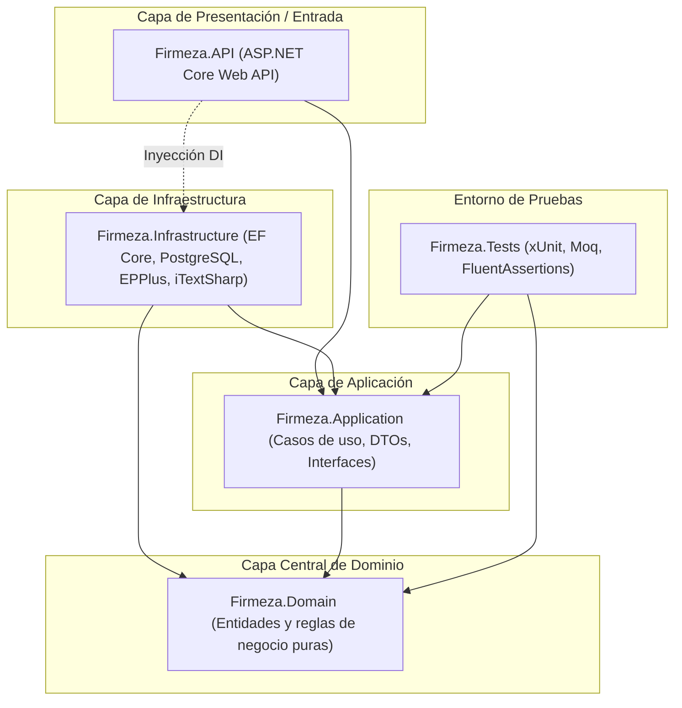

# Firmeza - Plataforma de Gestión Comercial y Ventas

Sistema integral de gestión comercial, catálogo de productos, registro de ventas y facturación desarrollado bajo los principios de **Arquitectura Limpia (Clean Architecture)** en **.NET 10** y con frontend SPA en **React**.

---

## 🏛️ Arquitectura de la Solución

El proyecto implementa una arquitectura en capas concéntricas (Clean Architecture) garantizando la regla de dependencia hacia adentro:



### Estructura de Proyectos

* **`src/Firmeza.Domain`**: Núcleo del negocio. Contiene las entidades puras (POCOs), enumeraciones y contratos del dominio sin dependencias externas ni acoplamientos a frameworks.
* **`src/Firmeza.Application`**: Casos de uso de la aplicación, DTOs, reglas de validación e interfaces de servicios y repositorios.
* **`src/Firmeza.Infrastructure`**: Implementación de la persistencia de datos con Entity Framework Core y PostgreSQL, servicios de exportación/importación Excel (EPPlus) y generación de facturas PDF (iTextSharp).
* **`src/Firmeza.API`**: Punto de entrada de la aplicación. Expone controladores RESTful, autenticación mediante JWT y ASP.NET Core Identity, middleware y documentación interactiva OpenAPI/Swagger.
* **`tests/Firmeza.Tests`**: Pruebas unitarias automatizadas con xUnit, simulación de dependencias con Moq y aserciones expresivas con FluentAssertions.

---

## 🛠️ Stack Tecnológico

* **Lenguaje & Framework:** C# 13 / .NET 10.0
* **Acceso a Datos & ORM:** Entity Framework Core 10 + Npgsql (PostgreSQL)
* **Base de Datos:** PostgreSQL
* **Procesamiento de Archivos:**
  * EPPlus (Importación masiva de datos en Excel `.xlsx`)
  * iTextSharp (Generación de comprobantes de venta en PDF con cálculo de IVA 19%)
* **Seguridad & Autenticación:** ASP.NET Core Identity + Tokens JWT con roles de usuario
* **Pruebas:** xUnit, Moq, FluentAssertions
* **Documentación API:** OpenAPI / Swagger UI
* **Frontend:** React (Vite), Axios, React Router (en desarrollo)

---

## 📋 Estado del Plan de Trabajo (Roadmap)

| Historia de Usuario | Descripción | Estado |
| :--- | :--- | :---: |
| **US 1: Clean Architecture & xUnit** | Estructuración de proyectos, referencias de capas, Inyección de Dependencias modular y suite xUnit con Moq y FluentAssertions. | ✅ **Completado** |
| **US 2: Modelado DB-First en PostgreSQL** | Script DDL `schema.sql` (clientes, productos, ventas, detalles) y autogeneración de entidades con EF Core Scaffold. | ✅ **Completado** |
| **US 3: API REST para Panel Administrativo** | Controladores RESTful con DTOs, Swagger con Bearer JWT y autorización basada en roles (`Admin`). | ✅ **Completado** |
| **US 4: Procesamiento Excel y Generación PDF** | Carga masiva con EPPlus y facturación automática en PDF vía iTextSharp. | ⏳ *Pendiente* |
| **US 5: Módulo Frontend del Cliente (React)** | SPA con Vite + React, autenticación JWT, catálogo de productos y carrito de compras. | ⏳ *Pendiente* |

---

## 🚀 Guía de Inicio Rápido

### Prerrequisitos
* [.NET 10 SDK](https://dotnet.microsoft.com/download)
* [PostgreSQL](https://www.postgresql.org/) (versión 14 o superior)
* [Node.js](https://nodejs.org/) (versión 18+ para el frontend)

### Compilación y Ejecución de Pruebas

1. **Restaurar paquetes y compilar la solución:**
   ```bash
   dotnet build
   ```

2. **Ejecutar las pruebas unitarias:**
   ```bash
   dotnet test
   ```

3. **Iniciar la Web API:**
   ```bash
   dotnet run --project src/Firmeza.API
   ```
