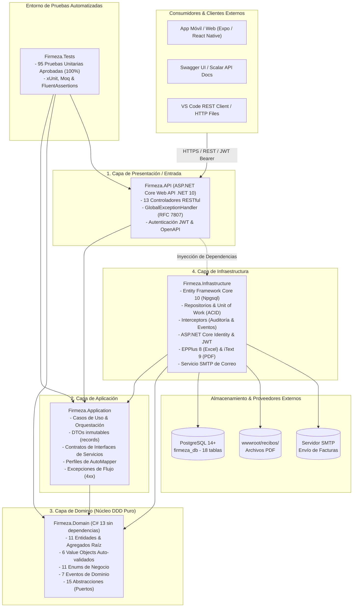
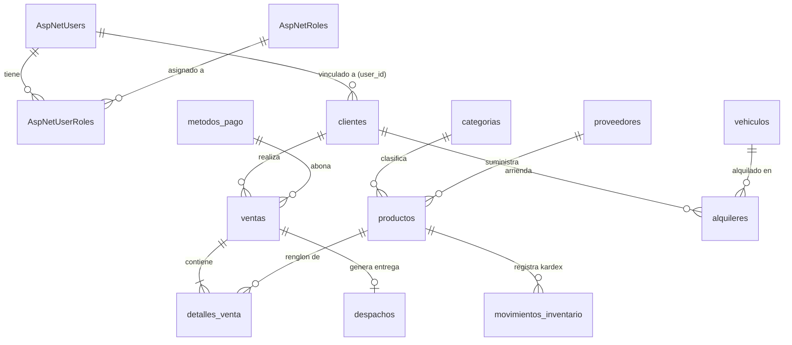

# Firmeza - Plataforma de Gestión Comercial, Logística y Alquiler de Maquinaria

[](https://dotnet.microsoft.com/)
[](https://docs.microsoft.com/dotnet/csharp/)
[](https://www.postgresql.org/)
[](https://blog.cleancoder.com/uncle-bob/2012/08/13/the-clean-architecture.html)
[](tests/Firmeza.Tests)
[](http://localhost:5125/swagger)

Sistema integral de gestión comercial mayorista para ferreterías, distribución y logística de materiales a pie de obra, alquiler de flota y maquinaria pesada de construcción, y facturación con cálculo automatizado de impuestos (IVA 19%).

El backend está desarrollado bajo los principios de **Clean Architecture (Arquitectura Limpia)** y **Domain-Driven Design (DDD)** sobre **.NET 10 (C# 13)** con persistencia relacional en **PostgreSQL**, documentación interactiva dual en **Swagger UI** y **Scalar API**, y soporte para clientes multiplataforma (Móvil y Web en **Expo / React Native**).

---

## 🏛️ Arquitectura de la Solución

El proyecto sigue una arquitectura en capas concéntricas con estricto cumplimiento de la regla de dependencias (las capas externas conocen a las internas, nunca a la inversa):



---

## 🗂️ Estructura Global del Repositorio

```text
Firmeza/
├── database/                                     # Scripts DDL/DML para PostgreSQL (18 tablas)
│   ├── migrations/                               # Migraciones de saneamiento y consolidación SQL
│   │   └── 01_consolidate_categories.sql         # Consolidación del catálogo maestro de 20 categorías
│   ├── schema.sql                                # Esquema DDL maestro (Identity + Dominio Comercial)
│   └── seed_data.sql                             # Datos iniciales DML (usuarios, roles, productos, vehículos)
│
├── src/                                          # Código fuente dividido en 4 capas concéntricas
│   ├── Firmeza.Domain/                           # 🟡 Capa de Dominio: Núcleo DDD puro e independiente
│   │   ├── Abstractions/                         # Contratos de persistencia, tiempo y eventos (15 contratos)
│   │   ├── Common/                               # Clases base DDD (ValueObject, AggregateRoot, IDomainEvent)
│   │   ├── Entities/                             # 11 Entidades y Agregados raíz del negocio
│   │   ├── Enums/                                # 11 Enumeraciones fuertemente tipadas
│   │   ├── Errors/                               # Catálogo estructurado de errores de negocio
│   │   ├── Events/                               # 7 Eventos de dominio desacoplados
│   │   ├── Exceptions/                           # Excepciones que protegen invariantes de negocio
│   │   ├── ValueObjects/                         # 6 Objetos de valor inmutables y auto-validados
│   │   └── Firmeza.Domain.csproj                 # .NET 10 sin dependencias externas
│   │
│   ├── Firmeza.Application/                      # 🔵 Capa de Aplicación: Casos de uso y orquestación
│   │   ├── DTOs/                                 # Objetos de transferencia inmutables (records)
│   │   ├── Exceptions/                           # Excepciones de aplicación traducidas a HTTP 4xx
│   │   ├── Interfaces/                           # Contratos de servicios de aplicación
│   │   ├── Mappings/                             # Perfiles de AutoMapper (MappingProfile)
│   │   ├── DependencyInjection.cs                # Registro de servicios de aplicación
│   │   └── Firmeza.Application.csproj
│   │
│   ├── Firmeza.Infrastructure/                   # 🟣 Capa de Infraestructura: Persistencia y servicios externos
│   │   ├── Persistence/                          # Módulo de persistencia relacional con EF Core 10
│   │   │   ├── Configurations/                   # 11 Clases IEntityTypeConfiguration fluidas (SRP)
│   │   │   ├── Interceptors/                     # Auditoría automática de fechas y despacho de eventos
│   │   │   ├── Migrations/                       # Registro de versionamiento (.gitkeep)
│   │   │   ├── Repositories/                     # GenericRepository, 10 repositorios concretos y UnitOfWork
│   │   │   ├── Seeders/                          # IDbSeeder y DbSeeder idempotente
│   │   │   ├── ApplicationDbContext.cs           # Contexto EF Core modular mapeando 18 tablas
│   │   │   └── AppDbContext.cs                   # Subclase / alias de conveniencia
│   │   ├── Services/                             # Implementaciones concretas (JWT, Excel, PDF, Email, CRUDs)
│   │   ├── DependencyInjection.cs                # Inyección centralizada de persistencia y servicios
│   │   └── Firmeza.Infrastructure.csproj
│   │
│   └── Firmeza.API/                              # 🔴 Capa de Presentación: ASP.NET Core Web API
│       ├── Controllers/                          # 13 Controladores RESTful
│       ├── Middleware/                           # GlobalExceptionHandlerMiddleware (RFC 7807)
│       ├── Properties/                           # launchSettings.json (Perfiles HTTP 5125 y HTTPS 7049)
│       ├── wwwroot/recibos/                      # Almacén de comprobantes PDF generados
│       ├── appsettings.json                      # Configuración de base de datos, JWT y SMTP
│       ├── appsettings.Development.json          # Sobrescritura de entorno de desarrollo
│       ├── Program.cs                            # Host, pipeline HTTP, CORS, OpenAPI, Swagger y Scalar
│       ├── Firmeza.API.http                      # Pruebas HTTP interactivas listas para ejecutar
│       └── Firmeza.API.csproj
│
├── tests/                                        # 🟢 Capa de Pruebas Automatizadas
│   └── Firmeza.Tests/                            # 95 Pruebas unitarias (xUnit, Moq, FluentAssertions)
│       ├── ApplicationExceptionsTests.cs
│       ├── AutoMapperTests.cs
│       ├── ClienteServiceTests.cs
│       ├── CommercialDomainTests.cs
│       ├── DashboardControllerTests.cs
│       ├── DependencyInjectionTests.cs
│       ├── DesnormalizedExcelTests.cs
│       ├── DomainDddTests.cs
│       ├── DomainEntityTests.cs
│       ├── EmailServiceTests.cs
│       ├── GlobalExceptionHandlerMiddlewareTests.cs
│       ├── ProductoServiceTests.cs
│       ├── ProductsControllerTests.cs
│       ├── SalesControllerTests.cs
│       ├── VentaServiceTests.cs
│       └── Firmeza.Tests.csproj
│
├── TAREAS_AZURE_US5.md                           # Plan de tareas Azure DevOps para la app móvil/web del cliente
├── Firmeza.sln                                   # Solución maestra (.NET 10)
└── README.md                                     # Documentación viva del proyecto
```

---

## 📂 Mapa Detallado de Responsabilidades y Arquitectura (Guía de Analogías de Obra y Precisión Técnica)

> 💡 **Metáfora Rectora de la Solución:**  
> Imagina la plataforma **Firmeza** como una **Megaempresa Constructora y Distribuidora Ferretera Industrial**.  
> Para que un rascacielos o un viaducto no colapse, no se puede mezclar la arena con los contratos notariales, ni permitir que un cliente entre a soldar al taller sin casco ni credencial. Cada departamento de la organización tiene una misión rigurosamente aislada y delimitada:
> * 🟡 **Dominio:** *Las Leyes de la Física, los Planos Maestros de Ingeniería y el Código Sismo Resistente (NSR-10)*. Son las reglas fundamentales e inviolables del negocio; no dependen de computadores ni de qué camión haga el reparto.
> * 🔵 **Aplicación:** *La Dirección de Operaciones, los Jefes de Cuadrilla y las Planillas de Trámite*. Coordinan los pasos de cada trabajo, verifican planos y dan órdenes de trabajo estandarizadas.
> * 🟣 **Infraestructura:** *La Bodega Central, los Montacargas, la Imprenta de Facturas y la Flota de Camiones*. Las herramientas pesadas que ejecutan el trabajo físico real (PostgreSQL, EPPlus, iText, SMTP).
> * 🔴 **Presentación (API):** *La Garita de Vigilancia, la Recepción Principal y las Ventanillas de Atención al Cliente*. La cara visible hacia los constructores y compradores; valida identidades y entrega respuestas ordenadas.
> * 🟢 **Pruebas (Tests):** *El Laboratorio de Control de Calidad y Ensayos Sísmicos Destructivos*. Somete los materiales y procesos a estrés extremo para certificar que jamás fallen en producción.
> * 🗃️ **Base de Datos:** *El Terreno Geológico y las Columnas de Concreto Armado*. El estrato firme sobre el que reposan todos los cimientos.
> * 📱 **US 5 (Frontend):** *La Nueva Sucursal Digital y Móvil*. La app en el celular del maestro de obra para comprar o alquilar desde cualquier lugar.

---

### 1. 🟡 Capa de Dominio: `src/Firmeza.Domain`

> 🏛️ **Analogía:** *El Código Nacional de Construcción y las Leyes de Resistencia de Materiales*.  
> **Propósito Técnico:** Es el núcleo ontológico más interno del sistema. No posee referencias a librerías externas de NuGet, Entity Framework, ASP.NET Core ni bases de datos. Si la tecnología del mundo cambiara mañana de PostgreSQL a almacenamiento cuántico, esta capa permanecería 100% idéntica e inmutable.

```text
src/Firmeza.Domain/
├── Abstractions/         # 📑 Los Contratos Notariales y Especificaciones Técnicas (Puertos)
├── Common/               # 🧱 Los Ladrillos Maestros y Moldes Estructurales (Primitivas DDD)
├── Entities/             # 🏗️ Los Bienes Físicos, Actores y Contratos Reales (Entidades y Agregados)
├── Enums/                # 🚦 El Semáforo, Balizas y Señalizaciones Oficiales de Obra
├── Errors/               # 🚨 El Catálogo de Alertas y Códigos de Falla Estructurados
├── Events/               # 📻 El Sistema de Radioteléfonos y Sirenas de la Obra (Eventos de Dominio)
├── Exceptions/           # 🛑 Los Frenos de Emergencia Automáticos (Excepciones de Dominio)
└── ValueObjects/         # 📐 Los Instrumentos de Medición Calibrados con Láser (Inmutables)
```

#### 📁 `Common/` (Las Primitivas y Moldes Fundamentales de DDD)
* *Analogía:* Las varillas de acero estructural y las formaletas de fundición estándar que se reutilizan en toda la obra.
* [`ValueObject.cs`](src/Firmeza.Domain/Common/ValueObject.cs): *El molde de fundición idéntico*. Clase base abstracta. Establece que dos objetos no se diferencian por un número de ID ficticio, sino por sus valores intrínsecos. Implementa igualdad profunda por componentes (`GetEqualityComponents()`) y sobrecarga los operadores `==` y `!=` para prevenir comparaciones erróneas por referencia de memoria.
* [`AggregateRoot.cs`](src/Firmeza.Domain/Common/AggregateRoot.cs): *El contenedor marítimo sellado con radio transmisor incorporado*. Clase base para las entidades líderes de un conjunto comercial (ej. `Venta`, `Producto`, `Alquiler`). Mantiene una cola interna protegida de eventos de dominio (`_domainEvents`) mediante `AddDomainEvent()` y `ClearDomainEvents()`, garantizando que cualquier cambio de estado crítico pueda comunicarse al exterior de forma desacoplada.
* [`IDomainEvent.cs`](src/Firmeza.Domain/Common/IDomainEvent.cs): *La señal radial de aviso con marca de tiempo*. Interfaz marcadora que exige a todo evento portar una marca temporal inmutable en tiempo universal coordinado (`OccurredOn = DateTime.UtcNow`).

#### 📁 `ValueObjects/` (Instrumentos de Medición de Precisión Calibrados)
* *Analogía:* Los calibradores de precisión Vernier, balanzas electrónicas de laboratorio y medidores láser. Si una medida o formato no cumple la norma exacta, el instrumento emite un sonido y se niega a registrar la lectura.
* [`Dinero.cs`](src/Firmeza.Domain/ValueObjects/Dinero.cs): *La balanza de precisión de tesorería*. Encapsula importe financiero en formato `decimal` y moneda (`COP`). Impide que existan valores negativos mediante `ValorInvalidoException`, implementa redondeo contable bancario (a 2 decimales) y sobrecarga operadores aritméticos (`+`, `-`, `*`) para erradicar cualquier error de precisión o números flotantes fantasma.
* [`CodigoSku.cs`](src/Firmeza.Domain/ValueObjects/CodigoSku.cs): *El código troquelado en la viga de acero*. Normaliza el identificador de bodega a mayúsculas, elimina espacios periféricos y valida que el código no sea nulo ni exceda los límites de longitud (ej. `PROD-001`), evitando que existan códigos de almacén en blanco o desordenados.
* [`Placa.cs`](src/Firmeza.Domain/ValueObjects/Placa.cs): *La placa metálica oficial del Ministerio de Transporte*. Exige el estándar vehicular colombiano de tres letras, guion opcional y tres dígitos (o dos dígitos y una letra para motocicletas/remolques, ej. `WXC-456`), normalizándola automáticamente a mayúsculas.
* [`Nit.cs`](src/Firmeza.Domain/ValueObjects/Nit.cs): *El sello tributario de la DIAN*. Valida la estructura alfanumérica del Número de Identificación Tributaria o Cédula de Ciudadanía con su respectivo dígito de verificación, impidiendo registrar empresas con identificaciones fiscales inválidas.
* [`Email.cs`](src/Firmeza.Domain/ValueObjects/Email.cs): *La dirección postal con buzón homologado*. Aplica validación sintáctica de expresiones regulares RFC 5322 y normaliza automáticamente la dirección a minúsculas para comparaciones y búsquedas uniformes.
* [`Telefono.cs`](src/Firmeza.Domain/ValueObjects/Telefono.cs): *La línea telefónica directa validada por conmutador*. Depura caracteres especiales y restringe la longitud a un rango numérico estricto de 7 a 15 dígitos.

#### 📁 `Entities/` (Los Bienes Físicos, Actores Comerciales y Contratos Notariados)
* *Analogía:* Los activos de la constructora que tienen cédula o número de serie propio, cambian de estado con el tiempo y tienen un ciclo de vida duradero.
* [`Producto.cs`](src/Firmeza.Domain/Entities/Producto.cs): *El material físico en estantería con sensor de stock*. Agregado raíz. Protege su inventario de forma atómica: los métodos `DescontarStock(int cantidad)` e `IncrementarStock(int cantidad)` bloquean transacciones que intenten dejar el stock en negativo arrojando `StockInsuficienteException`. Dispara `StockBajoDomainEvent` cuando las existencias tocan el umbral de alerta (<= 10 unidades) y gestiona la desactivación lógica (`Desactivar()`).
* [`Venta.cs`](src/Firmeza.Domain/Entities/Venta.cs): *La factura comercial oficial de caja registradora*. Agregado raíz. Encapsula cliente, medio de pago, lista de renglones (`DetalleVenta`), calcula automáticamente el impuesto del IVA (19%) sobre el subtotal, totaliza la transacción y gestiona estados (`Completada`, `Anulada`). Al cancelarse mediante `Cancelar()`, emite `VentaCanceladaDomainEvent` para restituir el inventario.
* [`DetalleVenta.cs`](src/Firmeza.Domain/Entities/DetalleVenta.cs): *El renglón individual impreso en la factura*. Asocia el producto con la cantidad comprada y congela el precio unitario en el instante de la transacción, impidiendo que variaciones futuras de catálogo alteren la contabilidad pasada.
* [`Alquiler.cs`](src/Firmeza.Domain/Entities/Alquiler.cs): *El contrato formal de arrendamiento de maquinaria pesada*. Agregado raíz. Asocia cliente con maquinaria por un rango de fechas (`FechaInicio`, `FechaFin`), calcula automáticamente la duración en días y el costo total a partir de la tarifa diaria del equipo, transita estados (`Activo`, `Finalizado`, `Cancelado`) y emite `VehiculoLiberadoDomainEvent` al terminar el contrato.
* [`Vehiculo.cs`](src/Firmeza.Domain/Entities/Vehiculo.cs): *El camión o maquinaria con motor en el patio automotor*. Modela placa, marca, modelo, capacidad de carga en toneladas métricas, tarifa diaria de arrendamiento y disponibilidad (`Disponible`, `Alquilado`, `EnMantenimiento`).
* [`Despacho.cs`](src/Firmeza.Domain/Entities/Despacho.cs): *La remisión de transporte y guía de entrega a pie de obra*. Asocia una venta a una dirección de entrega, ciudad de destino, contacto receptor, costo de flete y ciclo logístico (`Pendiente`, `EnRuta`, `Entregado`, `Cancelado`).
* [`MovimientoInventario.cs`](src/Firmeza.Domain/Entities/MovimientoInventario.cs): *La ficha Kardex inmutable archivada por el bodeguero*. Documenta cada alteración del stock con su tipo (`Entrada`, `Salida`, `Ajuste`), cantidad afectada, stock previo, stock posterior, usuario responsable y justificación operativa.
* [`Cliente.cs`](src/Firmeza.Domain/Entities/Cliente.cs): *El expediente de cliente en la cartera comercial*. Custodia identificación única, nombres, apellidos, correo, teléfono, fecha de nacimiento con cálculo computado dinámico de `Edad` y vinculación opcional (`user_id`) con el usuario autenticado de Identity.
* [`Categoria.cs`](src/Firmeza.Domain/Entities/Categoria.cs): *El letrero colgante que identifica el pasillo de la tienda*. Agrupa los productos en las 20 líneas técnicas comerciales (Materiales, Acabados, Ferretería, Maquinaria pesada).
* [`Proveedor.cs`](src/Firmeza.Domain/Entities/Proveedor.cs): *El convenio marco con el fabricante mayorista*. Registra datos de contacto y NIT de aliados estratégicos como Cementos Argos, Gerdau Diaco o Pavco Wavin.
* [`MetodoPago.cs`](src/Firmeza.Domain/Entities/MetodoPago.cs): *La caja o canal de recaudo autorizado*. Efectivo en mostrador, Transferencia Bancaria (PSE), Tarjeta Débito/Crédito y Crédito Comercial a 30 días para firmas constructoras.

#### 📁 `Enums/` (El Semáforo, Balizas y Señales Oficiales de Tránsito en la Obra)
* *Analogía:* Las luces de baliza, los colores de los cascos de protección y las señales de tránsito pintadas en las vías de la obra para evitar confusiones humanas.
* [`EstadoVenta.cs`](src/Firmeza.Domain/Enums/EstadoVenta.cs): Semáforo comercial de facturas (`Pendiente`, `Completada`, `Anulada`).
* [`EstadoDespacho.cs`](src/Firmeza.Domain/Enums/EstadoDespacho.cs): Semáforo logístico de fletes (`Pendiente`, `EnRuta`, `Entregado`, `Cancelado`).
* [`EstadoVehiculo.cs`](src/Firmeza.Domain/Enums/EstadoVehiculo.cs): Disponibilidad en patio automotor (`Disponible`, `Alquilado`, `EnMantenimiento`).
* [`EstadoAlquiler.cs`](src/Firmeza.Domain/Enums/EstadoAlquiler.cs): Ciclo de vigencia de contratos de maquinaria (`Activo`, `Finalizado`, `Cancelado`).
* [`TipoMovimientoInventario.cs`](src/Firmeza.Domain/Enums/TipoMovimientoInventario.cs): Sentido del flujo físico de materiales (`Entrada`, `Salida`, `Ajuste`).
* [`TipoVehiculo.cs`](src/Firmeza.Domain/Enums/TipoVehiculo.cs): Tipología de maquinaria y transporte (Volquetas, Retroexcavadoras, Camiones de estacas, Mezcladoras tipo trompo, Camionetas 4x4).
* [`TipoMetodoPago.cs`](src/Firmeza.Domain/Enums/TipoMetodoPago.cs): Canales de cobranza autorizados (Efectivo, Transferencia, Tarjeta, Crédito 30 días, etc.).
* [`TipoIdentificacion.cs`](src/Firmeza.Domain/Enums/TipoIdentificacion.cs): Documentos legales admitidos (CC, NIT, CE, RUT, Pasaporte).
* [`UnidadMedida.cs`](src/Firmeza.Domain/Enums/UnidadMedida.cs): Estándares de cubicación y peso (Bulto 50kg, Kilogramo, Tonelada, Metro lineal, Metro cúbico, Galón, Unidad).
* [`PrioridadDespacho.cs`](src/Firmeza.Domain/Enums/PrioridadDespacho.cs): Grado de urgencia del flete a obra (`Baja`, `Normal`, `Alta`, `Urgente`).
* [`EstadoCotizacion.cs`](src/Firmeza.Domain/Enums/EstadoCotizacion.cs): Ciclo de vida de propuestas comerciales (`Borrador`, `Enviada`, `Aprobada`, `Rechazada`, `Vencida`).

#### 📁 `Events/` (El Sistema de Radiocomunicación y Sirenas de Alarma)
* *Analogía:* El radioteléfono de canal abierto en la solapa del ingeniero residente: cuando ocurre un hecho importante en un área, lo anuncia por radio para que los demás reaccionen en cadena sin acoplarse físicamente.
* [`VentaRegistradaDomainEvent.cs`](src/Firmeza.Domain/Events/VentaRegistradaDomainEvent.cs): *"¡Venta cobrada con éxito!"*. Desencadena la generación del PDF en disco y la notificación por correo SMTP.
* [`VentaCanceladaDomainEvent.cs`](src/Firmeza.Domain/Events/VentaCanceladaDomainEvent.cs): *"¡Alerta, venta anulada!"*. Desencadena la restitución automática de existencias al almacén.
* [`StockBajoDomainEvent.cs`](src/Firmeza.Domain/Events/StockBajoDomainEvent.cs): *"¡Sirena amarilla: existencias críticas en bodega (<= 10 unidades)!"*. Notifica al equipo de compras para reabastecimiento.
* [`VehiculoAlquiladoDomainEvent.cs`](src/Firmeza.Domain/Events/VehiculoAlquiladoDomainEvent.cs): *"¡Maquinaria asignada en contrato!"*. Bloquea el equipo en el parque automotor para evitar doble reserva.
* [`VehiculoLiberadoDomainEvent.cs`](src/Firmeza.Domain/Events/VehiculoLiberadoDomainEvent.cs): *"¡Maquinaria recibida y devuelta a patio!"*. Restablece el estado a disponible en el catálogo de alquiler.
* [`DespachoEnRutaDomainEvent.cs`](src/Firmeza.Domain/Events/DespachoEnRutaDomainEvent.cs): *"¡Camión en carretera rumbo a la construcción!"*. Notifica al receptor en sitio de la llegada inminente.
* [`DespachoEntregadoDomainEvent.cs`](src/Firmeza.Domain/Events/DespachoEntregadoDomainEvent.cs): *"¡Material descargado a conformidad en la obra!"*. Cierra formalmente la guía de remisión.

#### 📁 `Exceptions/` & `Errors/` (Las Paradas de Emergencia y el Libro de Averías)
* *Analogía:* Los botones tipo hongo de parada de emergencia en las grúas: si se detecta un peligro estructural, desconectan el motor en microsegundos antes de que cause un accidente.
* [`StockInsuficienteException.cs`](src/Firmeza.Domain/Exceptions/StockInsuficienteException.cs): *El sensor que frena la banda transportadora cuando no queda material físico*. Impide ventas que superen las existencias reales.
* [`ReglaNegocioException.cs`](src/Firmeza.Domain/Exceptions/ReglaNegocioException.cs): *El inspector que niega el ingreso por incumplimiento de protocolos*. Protege estados finales cerrados (facturas ya anuladas o tarifas negativas).
* [`ValorInvalidoException.cs`](src/Firmeza.Domain/Exceptions/ValorInvalidoException.cs): *El calibrador que expulsa un tornillo con rosca deforme*. Protege la integridad de los Value Objects.
* [`DomainException.cs`](src/Firmeza.Domain/Exceptions/DomainException.cs): Clase base de todas las fallas operativas internas del dominio.
* [`DomainError.cs`](src/Firmeza.Domain/Errors/DomainError.cs) y [`DomainErrors.cs`](src/Firmeza.Domain/Errors/DomainErrors.cs): *El libro oficial de códigos de avería y fallas*. Proporciona códigos y descripciones estructuradas y localizadas para clientes, productos, ventas, logística y flota.

#### 📁 `Abstractions/` (Los Contratos Notariales y Especificaciones Técnicas - Puertos)
* *Analogía:* Los pliegos de licitación pública que exigen: *"La empresa que provea el servicio de custodia de datos debe contar con bóveda ignífuga y transacciones atómicas"*. Al Dominio no le importa si es PostgreSQL, SQL Server o un servicio en la nube quien cumpla la tarea, siempre y cuando satisfaga el pliego.
* [`IUnitOfWork.cs`](src/Firmeza.Domain/Abstractions/IUnitOfWork.cs): *El protocolo de la bóveda bancaria*. Exige que todas las operaciones de una orden se guarden juntas en una sola transacción atómica (`SaveChangesAsync`), con control explícito de `BeginTransactionAsync`, `CommitTransactionAsync` y `RollbackTransactionAsync`.
* [`IRepository.cs`](src/Firmeza.Domain/Abstractions/IRepository.cs): *El contrato base del bodeguero general*. Define métodos universales de persistencia (`GetByIdAsync`, `GetAllAsync`, `FindAsync`, `AddAsync`, `Update`, `Remove`, `ExistsAsync`).
* Contratos especializados de persistencia: [`IClienteRepository.cs`](src/Firmeza.Domain/Abstractions/IClienteRepository.cs), [`IProductoRepository.cs`](src/Firmeza.Domain/Abstractions/IProductoRepository.cs), [`IVentaRepository.cs`](src/Firmeza.Domain/Abstractions/IVentaRepository.cs), [`IVehiculoRepository.cs`](src/Firmeza.Domain/Abstractions/IVehiculoRepository.cs), [`IAlquilerRepository.cs`](src/Firmeza.Domain/Abstractions/IAlquilerRepository.cs), [`IDespachoRepository.cs`](src/Firmeza.Domain/Abstractions/IDespachoRepository.cs), [`IMovimientoInventarioRepository.cs`](src/Firmeza.Domain/Abstractions/IMovimientoInventarioRepository.cs), [`ICategoriaRepository.cs`](src/Firmeza.Domain/Abstractions/ICategoriaRepository.cs), [`IProveedorRepository.cs`](src/Firmeza.Domain/Abstractions/IProveedorRepository.cs).
* [`IDomainEventDispatcher.cs`](src/Firmeza.Domain/Abstractions/IDomainEventDispatcher.cs) e [`IDomainEventHandler.cs`](src/Firmeza.Domain/Abstractions/IDomainEventHandler.cs): *La torre de control repetidora y las cuadrillas de respuesta rápida*. Despachan y consumen eventos de dominio de forma asíncrona.
* [`IDateTimeProvider.cs`](src/Firmeza.Domain/Abstractions/IDateTimeProvider.cs): *El reloj atómico maestro de la compañía*. Abstrae `DateTime.UtcNow` permitiendo simular fechas pasadas o futuras en pruebas unitarias deterministas.
* [`ISpecification.cs`](src/Firmeza.Domain/Abstractions/ISpecification.cs): *El tamiz o zaranda de clasificación*. Permite componer filtros de consulta complejos y reutilizables.

---

### 2. 🔵 Capa de Aplicación: `src/Firmeza.Application`

> 📋 **Analogía:** *La Dirección de Operaciones, los Jefes de Cuadrilla y las Planillas de Trámite*.  
> **Propósito Técnico:** Orquesta los casos de uso del sistema. Conoce el Dominio y define qué tareas deben realizarse, pero desconoce por completo la tecnología de la base de datos o el protocolo HTTP. Define las fichas de datos inmutables (DTOs), las excepciones de negocio de nivel aplicación y los contratos de servicios de infraestructura.

```text
src/Firmeza.Application/
├── DTOs/                     # 📝 Las Planillas de Pedido y Fichas de Trámite Inmutables (records)
├── Exceptions/               # 🚫 Las Boletas Oficiales de Rechazo de Trámite en Ventanilla (4xx)
├── Interfaces/               # 📜 Los Manuales de Procedimientos Estandarizados (SOP)
├── Mappings/                 # 🌐 El Perito Traductor Simultáneo (AutoMapper)
├── DependencyInjection.cs    # 🤝 El Registro de Servicios de la Capa de Aplicación
└── Firmeza.Application.csproj
```

#### 📁 `DTOs/` (Planillas de Pedido y Fichas de Trámite Inmutables)
* *Analogía:* Las hojas de papel autocopiante y planillas estándar con casillas exactas. No contienen lógica de negocio pesada, solo los datos justos y seguros que viajan hacia y desde los clientes.
* [`AuthDto.cs`](src/Firmeza.Application/DTOs/AuthDto.cs): *El formulario de carnetización y acceso*. Records `LoginDto` (credenciales de entrada), `RegisterDto` (afiliación) y `AuthResponseDto` (token JWT y metadatos del usuario).
* [`ProductoDto.cs`](src/Firmeza.Application/DTOs/ProductoDto.cs): *La ficha de catálogo comercial del material*. Proyecta el producto con los nombres calculados de `CategoriaNombre` y `ProveedorRazonSocial`, protegiendo entidades internas.
* [`CategoriaDto.cs`](src/Firmeza.Application/DTOs/CategoriaDto.cs): *La ficha del pasillo comercial*. Record `CategoriaDto` enriquecido con el cálculo en vivo de `TotalProductos`, `CreateCategoriaDto` y `UpdateCategoriaDto`.
* [`VentaDto.cs`](src/Firmeza.Application/DTOs/VentaDto.cs): *La proforma de liquidación y factura de compra*. Desglosa cliente, medio de pago, subtotal, IVA (19%), total y la lista de renglones (`DetalleVentaDto`).
* [`ClienteDto.cs`](src/Firmeza.Application/DTOs/ClienteDto.cs): *El expediente de afiliación de cliente*. Transporta datos de contacto y el cálculo de mayoría de edad.
* [`CommercialDtos.cs`](src/Firmeza.Application/DTOs/CommercialDtos.cs): *Los formatos de remisión secundaria*. DTOs para Proveedores, Medios de Pago, Flota (`VehiculoDto`), Contratos de Alquiler, Guías de Despacho y Tarjetas Kardex.
* [`DashboardDto.cs`](src/Firmeza.Application/DTOs/DashboardDto.cs): *El informe ejecutivo para la junta directiva*. Resumen de recaudación, órdenes activas, productos con stock bajo y top 5 artículos más vendidos.
* [`ExcelDto.cs`](src/Firmeza.Application/DTOs/ExcelDto.cs): *El manifiesto de carga masiva en planilla*. Registros planos para importar o exportar lotes de inventario desde hojas de cálculo.

#### 📁 `Exceptions/` (Las Boletas Oficiales de Rechazo de Trámite en Ventanilla)
* *Analogía:* Cuando un cliente presenta un trámite incompleto o contradictorio, el jefe de operaciones le sella la hoja con el motivo exacto para que sepa exactamente qué corregir.
* [`NotFoundException.cs`](src/Firmeza.Application/Exceptions/NotFoundException.cs): *"El registro solicitado no existe en los archivos"* -> Mapea limpiamente a **HTTP 404 Not Found**.
* [`ConflictException.cs`](src/Firmeza.Application/Exceptions/ConflictException.cs): *"Ya existe un registro con ese documento único, NIT o placa"* -> Mapea a **HTTP 409 Conflict**.
* [`ValidationException.cs`](src/Firmeza.Application/Exceptions/ValidationException.cs): *"El formulario presenta casillas obligatorias vacías o formatos no válidos"* -> Mapea a **HTTP 400 Bad Request**.
* [`ForbiddenAccessException.cs`](src/Firmeza.Application/Exceptions/ForbiddenAccessException.cs): *"No posee el nivel jerárquico ni la autorización requerida para este trámite"* -> Mapea a **HTTP 403 Forbidden**.

#### 📁 `Interfaces/` (Los Manuales de Procedimientos Estandarizados - SOP)
* *Analogía:* El manual de operaciones de la compañía: lista cada trámite que cualquier área puede solicitar al personal de operaciones.
* [`IClienteService.cs`](src/Firmeza.Application/Interfaces/IClienteService.cs): Contrato de gestión de cartera, verificación de duplicados, actualización y borrado seguro de clientes.
* [`IProductoService.cs`](src/Firmeza.Application/Interfaces/IProductoService.cs): Contrato de catálogo, actualización atómica de existencias y desactivación lógica.
* [`IVentaService.cs`](src/Firmeza.Application/Interfaces/IVentaService.cs): Contrato del ciclo de venta, cálculo tributario de IVA, emisión de recibos y anulación.
* [`IDashboardService.cs`](src/Firmeza.Application/Interfaces/IDashboardService.cs): Contrato para cálculo y agregación en tiempo real de indicadores comerciales.
* [`IJwtTokenService.cs`](src/Firmeza.Application/Interfaces/IJwtTokenService.cs): Contrato de expedición y validación criptográfica de tokens JWT.
* [`IExcelService.cs`](src/Firmeza.Application/Interfaces/IExcelService.cs): Contrato de procesamiento masivo de hojas de cálculo EPPlus.
* [`IPdfService.cs`](src/Firmeza.Application/Interfaces/IPdfService.cs): Contrato de diagramación y generación de facturas en PDF con iText.
* [`IEmailService.cs`](src/Firmeza.Application/Interfaces/IEmailService.cs): Contrato de despacho de mensajería postal electrónica con adjuntos.

#### 📁 `Mappings/` (El Perito Traductor Simultáneo)
* *Analogía:* El perito traductor oficial que convierte instantáneamente las palabras del cliente (DTOs) al lenguaje técnico de ingeniería de los planos (Entidades) y viceversa.
* [`MappingProfile.cs`](src/Firmeza.Application/Mappings/MappingProfile.cs): Configuración centralizada de AutoMapper 16. Mapea bidireccionalmente las 11 entidades y DTOs, resolviendo propiedades computadas (`CategoriaNombre`, `TotalProductos`, `DiasAlquiler`).

#### 📄 `DependencyInjection.cs`
* *Analogía:* La lista donde la oficina de operaciones registra qué traductores y manuales están disponibles en la empresa (`AddApplicationServices()`).

---

### 3. 🟣 Capa de Infraestructura: `src/Firmeza.Infrastructure`

> 🏭 **Analogía:** *La Bodega Central de Concreto, los Montacargas, la Flota de Camiones y los Talleres de Soporte*.  
> **Propósito Técnico:** Es la capa de los fierros y la tecnología concreta. Conecta con el servidor PostgreSQL mediante Entity Framework Core 10, maneja la seguridad con ASP.NET Core Identity, almacena archivos en disco, imprime documentos PDF con iText 9, procesa hojas Excel con EPPlus 8 y envía correos por SMTP.

```text
src/Firmeza.Infrastructure/
├── Persistence/                      # 🏢 La Bóveda Subterránea y el Almacén Automatizado
│   ├── Configurations/              # 🗄️ Los Anaqueles con Medidas Exactas (IEntityTypeConfiguration)
│   ├── Interceptors/                # 🎥 Las Cámaras y Sensores Automáticos de Entrada (Auditoría/Eventos)
│   ├── Migrations/                  # 📐 El Historial de Reformas Arquitectónicas (.gitkeep)
│   ├── Repositories/                # 🚜 Los Operarios de Bodega con Montacargas y la Caja Fuerte
│   ├── Seeders/                     # 📦 La Dotación Inicial del Almacén (DbSeeder)
│   ├── ApplicationDbContext.cs      # 📖 El Libro Mayor de Contabilidad y Mapeo Central
│   └── AppDbContext.cs              # 📖 Subclase y Alias Corto de Conveniencia
├── Services/                         # 🛠️ Los Talleres de Especialistas Industriales
│   ├── ClienteService.cs
│   ├── ProductoService.cs
│   ├── VentaService.cs
│   ├── DashboardService.cs
│   ├── JwtTokenService.cs           # 🪪 Taller de Carnetización con Holograma Criptográfico
│   ├── ExcelService.cs              # 📊 Máquina Procesadora de Manifiestos de Carga (EPPlus)
│   ├── PdfService.cs                # 🖨️ Imprenta Oficial de Facturas Comerciales (iText)
│   └── EmailService.cs              # 📬 Mensajero Postal Motorizado (SMTP)
├── DependencyInjection.cs            # ⚡ El Tablero Eléctrico General de Infraestructura
└── Firmeza.Infrastructure.csproj
```

#### 📁 `Persistence/` (La Bóveda Subterránea y el Almacén Automatizado)
* *Analogía:* El búnker físico donde se almacenan todos los bienes y donde reposan los libros de actas oficiales.
* [`ApplicationDbContext.cs`](src/Firmeza.Infrastructure/Persistence/ApplicationDbContext.cs) & [`AppDbContext.cs`](src/Firmeza.Infrastructure/Persistence/AppDbContext.cs): *El Libro Mayor Contable*. Hereda de `IdentityDbContext`, administra las 18 tablas de PostgreSQL y descubre y aplica automáticamente todas las configuraciones fluidas mediante `ApplyConfigurationsFromAssembly`.
* **`Configurations/`:** *Los anaqueles y estanterías fabricados a medida*. 11 clases `IEntityTypeConfiguration<T>` independientes (una por entidad, respetando SRP). Le dictan a PostgreSQL las precisiones de columnas (`numeric(14,2)`, `varchar(200)`), restricciones de unicidad, llaves foráneas e índices de rendimiento.
* **`Interceptors/`:** *Las cámaras inteligentes y sensores perimétricos*:
  * [`AuditableEntityInterceptor.cs`](src/Firmeza.Infrastructure/Persistence/Interceptors/AuditableEntityInterceptor.cs): *El reloj estampador automático*. Intercepta cada operación de guardado y estampa automáticamente la fecha UTC de creación o modificación sin requerir intervención humana.
  * [`DispatchDomainEventsInterceptor.cs`](src/Firmeza.Infrastructure/Persistence/Interceptors/DispatchDomainEventsInterceptor.cs): *La antena perimetral de radio*. Justo antes de confirmar la transacción (`SavingChangesAsync`), captura todos los eventos de dominio acumulados en los agregados raíz y los transmite inmediatamente a sus suscriptores.
* **`Repositories/`:** *Los operarios de bodega con montacargas*.
  * [`GenericRepository<T>`](src/Firmeza.Infrastructure/Persistence/Repositories/GenericRepository.cs): El operario general que sabe archivar, buscar, listar o retirar cualquier elemento estándar.
  * Repositorios específicos (`ProductoRepository`, `VentaRepository`, `VehiculoRepository`, `AlquilerRepository`, etc.): Expertos que conocen las rutas complejas de su sección (buscar por SKU, alertar stock bajo, consultar maquinaria disponible para obra).
  * [`UnitOfWork.cs`](src/Firmeza.Infrastructure/Persistence/Repositories/UnitOfWork.cs): *El candado de la caja fuerte bancaria*. Garantiza atomicidad estricta (o todo el pedido se cobra y descuenta completo, o la operación se cancela intacta).
* **`Seeders/`:** *La dotación inicial de apertura de la tienda*.
  * [`DbSeeder.cs`](src/Firmeza.Infrastructure/Persistence/Seeders/DbSeeder.cs) e [`IDbSeeder.cs`](src/Firmeza.Infrastructure/Persistence/Seeders/IDbSeeder.cs): Al inaugurar el sistema, crea de forma idempotente los 10 roles del personal, el usuario superadministrador y los medios de pago obligatorios.

#### 📁 `Services/` (Los Talleres de Especialistas Industriales)
* *Analogía:* Los talleres de manufactura y servicios especializados que asisten a la constructora.
* [`JwtTokenService.cs`](src/Firmeza.Infrastructure/Services/JwtTokenService.cs): *El taller de plastificado de carnets de seguridad*. Construye y firma credenciales JWT simétricas con HMAC-SHA256, inyectando el rol jerárquico, identificadores y tiempo de expiración.
* [`ExcelService.cs`](src/Firmeza.Infrastructure/Services/ExcelService.cs): *La máquina procesadora de manifiestos masivos de importación*. Utiliza EPPlus 8 para leer y generar hojas de cálculo de miles de filas, normalizando categorías y proveedores en memoria.
* [`PdfService.cs`](src/Firmeza.Infrastructure/Services/PdfService.cs): *La imprenta oficial de facturación con membrete*. Utiliza el motor gráfico iText 9 para diagramar comprobantes comerciales con tablas, desgloses tributarios y archivo en `wwwroot/recibos/`.
* [`EmailService.cs`](src/Firmeza.Infrastructure/Services/EmailService.cs): *El mensajero postal motorizado*. Conecta por SMTP seguro (TLS/SSL), inyecta plantillas HTML profesionales y adjunta la factura en PDF para el comprador.
* [`DashboardService.cs`](src/Firmeza.Infrastructure/Services/DashboardService.cs): *La pantalla de control de mando en la sala de juntas*. Agrega métricas en tiempo real de ingresos brutos, ventas del día, productos bajo stock y top de artículos.
* [`ClienteService.cs`](src/Firmeza.Infrastructure/Services/ClienteService.cs), [`ProductoService.cs`](src/Firmeza.Infrastructure/Services/ProductoService.cs), [`VentaService.cs`](src/Firmeza.Infrastructure/Services/VentaService.cs): Las cuadrillas operativas que ejecutan las directrices del negocio.

#### 📄 `DependencyInjection.cs`
* *Analogía:* El tablero eléctrico principal: conecta el suministro de PostgreSQL, los permisos de Identity, el servidor SMTP y los repositorios para energizar toda la infraestructura (`AddInfrastructureServices()`).

---

### 4. 🔴 Capa de Presentación: `src/Firmeza.API`

> 🏬 **Analogía:** *La Fachada Comercial, la Garita de Vigilancia y las Ventanillas de Atención al Público*.  
> **Propósito Técnico:** Es la única puerta de entrada al sistema por la red (HTTP/HTTPS). Expone 13 controladores RESTful protegidos por tokens JWT y roles, configura CORS para la app móvil y web, y estandariza los errores mediante el middleware RFC 7807.

```text
src/Firmeza.API/
├── Controllers/              # 💁‍♂️ Los 13 Asesores Comerciales y Ventanillas de Atención
├── Middleware/               # 🧐 El Inspector de Calidad y Protocolo en Ventanilla (RFC 7807)
├── Properties/               # 🚦 Configuración de Puertos y Perfiles de Ejecución
├── wwwroot/recibos/          # 🗄️ El Archivero Físico de Facturas PDF Generadas
├── appsettings.json          # 🔐 Caja Fuerte de Secretos, Cadenas de BD y Credenciales SMTP
├── appsettings.Development.json # 🛠️ Ajustes Especiales para el Banco de Pruebas Local
├── Program.cs                # 🔔 El Maestro de Ceremonias y Apertura de Puertas
├── Firmeza.API.http          # ⚡ La Carpeta de Pruebas Rápidas del Auditor
└── Firmeza.API.csproj
```

#### 📁 `Controllers/` (Los Asesores Comerciales en Mostrador)
* *Analogía:* Cada asesor atiende una ventanilla identificada con un letrero luminoso según su especialidad:
* [`AuthController.cs`](src/Firmeza.API/Controllers/AuthController.cs): *La ventanilla de recepción y carnetización*. Atiende `/login` para autenticar usuarios y `/register` para dar de alta clientes nuevos.
* [`ProductsController.cs`](src/Firmeza.API/Controllers/ProductsController.cs): *El mostrador de materiales y herramientas*. Catálogo, creación, actualización, soft-delete e importación/exportación masiva en Excel.
* [`CategoriesController.cs`](src/Firmeza.API/Controllers/CategoriesController.cs): *El directorio del centro comercial*. Consulta de las 20 familias, conteo de productos por línea y activación/desactivación.
* [`ClientsController.cs`](src/Firmeza.API/Controllers/ClientsController.cs): *La atención a empresas y constructores*. Registro de clientes, cálculo de edad y consultas de cartera.
* [`SalesController.cs`](src/Firmeza.API/Controllers/SalesController.cs): *La caja registradora principal*. Cobro de compras, emisión automática de factura PDF, anulación y exportación histórica a Excel.
* [`DispatchesController.cs`](src/Firmeza.API/Controllers/DispatchesController.cs): *La oficina de fletes y logística*. Programación de envíos a pie de obra y actualización de estados (`EnRuta`, `Entregado`).
* [`VehiclesController.cs`](src/Firmeza.API/Controllers/VehiclesController.cs): *El patio de exhibición de maquinaria*. Catálogo de volquetas, retroexcavadoras y camiones con tarifas de alquiler por día.
* [`RentalsController.cs`](src/Firmeza.API/Controllers/RentalsController.cs): *La mesa de contratos de arrendamiento de maquinaria*. Firma de contratos por días y liberación automática del equipo al terminar.
* [`InventoryMovementsController.cs`](src/Firmeza.API/Controllers/InventoryMovementsController.cs): *La taquilla de auditoría de inventario*. Consulta histórica de entradas, salidas y ajustes de stock.
* [`SuppliersController.cs`](src/Firmeza.API/Controllers/SuppliersController.cs): *La mesa de convenios con fábricas*. Gestión de proveedores y fabricantes mayoristas.
* [`PaymentMethodsController.cs`](src/Firmeza.API/Controllers/PaymentMethodsController.cs): *La ventanilla de medios de recaudo*. Habilitación y consulta de formas de pago aceptadas.
* [`DashboardController.cs`](src/Firmeza.API/Controllers/DashboardController.cs): *La pantalla de indicadores gerenciales*. Resumen consolidado para la dirección general.
* [`UsersController.cs`](src/Firmeza.API/Controllers/UsersController.cs): *La oficina de talento humano y credenciales*. Consulta de usuarios registrados y roles de Identity.

#### 📁 `Middleware/` (El Inspector de Calidad y Protocolo en Ventanilla)
* *Analogía:* El jefe de atención al cliente que observa detrás de las ventanillas: si un asesor tropieza o el cliente pide algo imposible, el inspector interviene cortésmente, redacta una nota estandarizada según la norma de calidad (RFC 7807 ProblemDetails) y se la entrega al cliente explicándole qué ocurrió sin gritar ni revelar los secretos internos de la bodega.
* [`GlobalExceptionHandlerMiddleware.cs`](src/Firmeza.API/Middleware/GlobalExceptionHandlerMiddleware.cs): Intercepta excepciones de cualquier capa y devuelve una respuesta estructurada con `Status`, `Title`, `Detail` e `Instance`:
  * `ValidationException` / `ValorInvalidoException` -> **HTTP 400 Bad Request**
  * `ForbiddenAccessException` -> **HTTP 403 Forbidden**
  * `NotFoundException` -> **HTTP 404 Not Found**
  * `ConflictException` / `ReglaNegocioException` -> **HTTP 409 Conflict**
  * `StockInsuficienteException` -> **HTTP 422 Unprocessable Entity**
  * Errores no controlados -> **HTTP 500 Internal Server Error**

#### 📄 `Program.cs` (El Maestro de Ceremonias y Protocolo de Apertura)
* *Analogía:* El gerente general que llega al amanecer, abre las rejas del edificio, enciende las luces, activa los detectores de humo, conecta el sistema de sonido y declara oficialmente inaugurada la atención al público.
* Inicializa el host, inyecta Application e Infrastructure, activa CORS para clientes móviles/web, autenticación JWT Bearer, documentación interactiva en **Swagger UI** y **Scalar API**, endpoints de bienvenida en `GET /` y `GET /api`, y ejecuta la siembra inicial con `DbSeeder`.

---

### 5. 🟢 Capa de Pruebas: `tests/Firmeza.Tests`

> 🔬 **Analogía:** *El Laboratorio de Control de Calidad y Ensayos Sísmicos Destructivos*.  
> **Propósito Técnico:** Suite automatizada con xUnit, Moq y FluentAssertions. Somete el software a cargas extremas y situaciones límite para garantizar 100% de fiabilidad y cero regresiones.

| Archivo de Prueba | 💡 Analogía de Ensayo en Laboratorio | 🎯 Componente Técnico Evaluado | Pruebas |
| :--- | :--- | :--- | :---: |
| [`DomainDddTests.cs`](tests/Firmeza.Tests/DomainDddTests.cs) | *El calibrador láser de instrumentos*: Comprueba que el Dinero no acepte centavos negativos, que las Placas sigan la norma y los SKUs no admitan espacios. | Value Objects (`Dinero`, `CodigoSku`, `Email`, `Nit`, `Placa`, `Telefono`), 3 E, Enums y Abstracciones | 20 |
| [`CommercialDomainTests.cs`](tests/Firmeza.Tests/CommercialDomainTests.cs) | *La prueba de carga de camiones*: Verifica que los contratos de alquiler calculen bien los días, los fletes cambien de estado en orden y el Kardex cuadre cada variación. | Entidades satélites (`Categoria`, `Vehiculo`, `Alquiler`, `Despacho`, `MovimientoInventario`) | 14 |
| [`DomainEntityTests.cs`](tests/Firmeza.Tests/DomainEntityTests.cs) | *La prueba de estrés de stock*: Simula compras masivas para verificar que el stock jamás quede negativo y el IVA del 19% se liquide al milímetro. | Reglas e invariantes de `Producto` y `Venta` | 6 |
| [`VentaServiceTests.cs`](tests/Firmeza.Tests/VentaServiceTests.cs) | *El simulacro de colapso de caja*: Prueba compras atómicas con rollback si algo falla, anulación de facturas y recarga automática de existencias. | Casos de uso de facturación, transaccionalidad ACID y reversión | 8 |
| [`ProductoServiceTests.cs`](tests/Firmeza.Tests/ProductoServiceTests.cs) | *La auditoría de pasillos*: Evalúa altas de materiales, alertas de stock bajo y desactivación lógica (*Soft Delete*). | Casos de uso de catálogo, stock y desactivación | 6 |
| [`ClienteServiceTests.cs`](tests/Firmeza.Tests/ClienteServiceTests.cs) | *El filtro de admisiones*: Evalúa el cálculo de edad y rechaza de inmediato clientes con cédulas o correos repetidos. | Cartera de clientes, unicidad y edad | 6 |
| [`DesnormalizedExcelTests.cs`](tests/Firmeza.Tests/DesnormalizedExcelTests.cs) | *La trituradora de planillas*: Carga hojas de Excel complejas y comprueba que se normalicen en memoria sin corromper la base de datos. | Importación masiva desnormalizada con EPPlus 8 | 4 |
| [`EmailServiceTests.cs`](tests/Firmeza.Tests/EmailServiceTests.cs) | *El ensayo del telégrafo postal*: Comprueba que las plantillas HTML se armen correctamente y los adjuntos PDF no se dañen al enviar. | Plantillas HTML y despacho SMTP con adjuntos | 3 |
| [`GlobalExceptionHandlerMiddlewareTests.cs`](tests/Firmeza.Tests/GlobalExceptionHandlerMiddlewareTests.cs) | *El simulacro de quejas en ventanilla*: Lanza fallas intencionales para verificar que el middleware responda con el código HTTP exacto bajo RFC 7807. | Mapeo HTTP de excepciones a ProblemDetails | 6 |
| [`ApplicationExceptionsTests.cs`](tests/Firmeza.Tests/ApplicationExceptionsTests.cs) | *La calibración de sellos de rechazo*: Valida que `NotFound`, `Conflict`, `Validation` y `Forbidden` lleven mensajes claros. | Excepciones tipadas de aplicación | 4 |
| [`AutoMapperTests.cs`](tests/Firmeza.Tests/AutoMapperTests.cs) | *El examen del perito traductor*: Valida que ninguna propiedad de los DTOs quede huérfana o mal mapeada desde las entidades. | Mapeos DTO <-> Entidad en MappingProfile | 3 |
| [`ProductsControllerTests.cs`](tests/Firmeza.Tests/ProductsControllerTests.cs) | *El comprador incógnito en productos*: Envía peticiones HTTP simuladas y valida respuestas 200 OK, 201 Created y 404 Not Found. | Endpoints REST de catálogo de productos | 5 |
| [`SalesControllerTests.cs`](tests/Firmeza.Tests/SalesControllerTests.cs) | *El comprador incógnito en la caja*: Prueba compras, anulaciones y solicitudes de comprobantes PDF. | Endpoints REST de facturación y ventas | 5 |
| [`DashboardControllerTests.cs`](tests/Firmeza.Tests/DashboardControllerTests.cs) | *La auditoría de la pantalla de junta directiva*: Verifica que los KPIs reportados coincidan con las ventas reales. | Endpoint REST de métricas del Dashboard | 3 |
| [`DependencyInjectionTests.cs`](tests/Firmeza.Tests/DependencyInjectionTests.cs) | *La prueba de cableado eléctrico general*: Confirma que todos los servicios y repositorios se resuelvan sin cables sueltos en el contenedor IoC. | Resolución de dependencias en IServiceCollection | 2 |
| **Total** | **Certificación de Resistencia Sísmica del Software** | **Suite Completa de Pruebas Unitarias** | **95 Aprobadas (100%)** |

---

### 6. 🗃️ Base de Datos: `database/`

> 🌍 **Analogía:** *El Terreno Geológico y las Columnas de Concreto Armado*.  
> **Propósito Técnico:** Es el lecho de roca sobre el que reposa todo el edificio. Si el terreno cede, todo el software colapsa. Por ello, está construido con acero estructural: llaves primarias, foráneas, restricciones de unicidad e índices optimizados.

* [`schema.sql`](database/schema.sql): *El plano maestro de excavación y cimentación*. Define las 18 tablas maestras (7 de ASP.NET Core Identity + 11 del dominio comercial), claves foráneas, índices de alta velocidad y el catálogo consolidado de 20 categorías.
* [`seed_data.sql`](database/seed_data.sql): *La entrega del edificio amoblado y listo para habitar*. Datos semilla con usuarios pre-cargados (hash PBKDF2), 10 roles, clientes reales, catálogo ferretero, vehículos de carga y maquinaria pesada.
* [`migrations/01_consolidate_categories.sql`](database/migrations/01_consolidate_categories.sql): *La remodelación y refuerzo estructural del edificio existente*. Depura categorías duplicadas previas y reasocia productos huérfanos sin suspender la operación comercial.

---

### 7. 📱 Bitácora de la Nueva Sucursal Digital: `TAREAS_AZURE_US5.md`

> 📲 **Analogía:** *El Cronograma de Construcción del Centro Comercial Digital*.  
> **Propósito Técnico:** Documenta la construcción de la sucursal virtual para que los constructores y clientes finales puedan comprar materiales y alquilar maquinaria pesada directamente desde su celular (Android/iOS) o navegador web mediante **Expo, React Native, Tailwind CSS (NativeWind) y Expo Router** (ubicado en `Firmeza.app/Firmeza`), registrando el progreso para el tablero de control de Azure DevOps.


---

## 🗄️ Modelo Relacional de Base de Datos (18 Tablas)

La base de datos relacional PostgreSQL (`firmeza_db`) organiza la información en 18 tablas:



### 1. Tablas de Seguridad y Acceso (ASP.NET Core Identity - 7 Tablas)
1. `AspNetRoles`: Roles de usuario (`Admin`, `Vendedor`, `Supervisor`, `Cajero`, `Gerente`, `Almacenista`, `Contador`, `Auditor`, `SoporteTecnico`, `Cliente`).
2. `AspNetUsers`: Cuentas de usuario con hash seguro PBKDF2 y marcas de seguridad.
3. `AspNetRoleClaims`: Privilegios asignados a nivel de rol.
4. `AspNetUserClaims`: Atributos adicionales del usuario.
5. `AspNetUserLogins`: Vinculación con proveedores externos (OAuth/Google).
6. `AspNetUserRoles`: Asignación muchos a muchos de usuarios con sus roles.
7. `AspNetUserTokens`: Tokens de sesión y actualización (Refresh Tokens).

### 2. Tablas del Dominio Comercial, Logístico y Flota (11 Tablas)
1. `categorias`: Catálogo maestro de 20 familias comerciales divididas en:
   * **Obra Gris y Estructuras:** Cementos y Agregados, Acero y Estructuras Metálicas, Mampostería y Drywall, Cubiertas y Techos, Madera y Formaletería.
   * **Instalaciones y Acabados:** Tuberías y Conexiones PVC, Material Eléctrico e Iluminación, Pinturas y Acabados, Impermeabilizantes y Aditivos, Plomería y Grifería, Pisos y Cerámicas.
   * **Ferretería y Seguridad:** Fijaciones y Tornillería, Herramientas Manuales, Herramientas Eléctricas y Corte, Seguridad Industrial y EPP, Cerrajería y Herrajes, Adhesivos y Selladores.
   * **Flota y Maquinaria de Construcción:** Maquinaria Pesada y Movimiento de Tierras, Vehículos de Carga y Transporte, Equipos de Construcción y Maquinaria Menor.
2. `proveedores`: Fabricantes y distribuidores aliados (Cementos Argos, Gerdau Diaco, Pavco Wavin).
3. `metodos_pago`: Medios de cobro (Efectivo, Tarjeta Débito/Crédito, Transferencia Bancaria, Crédito Comercial 30 Días).
4. `clientes`: Cartera de clientes con documento único, teléfono, dirección, edad y enlace opcional `user_id`.
5. `productos`: Materiales y artículos ferreteros con código SKU, precio base, stock y relación a categoría y proveedor.
6. `ventas`: Encabezado de factura comercial con cliente, medio de pago, fecha, subtotal, IVA (19%) y total.
7. `detalles_venta`: Renglones individuales de la factura con producto, cantidad, precio unitario y subtotal.
8. `despachos`: Logística y entrega de materiales a pie de obra con flete y trazabilidad.
9. `movimientos_inventario`: Kardex y auditoría histórica de variaciones de stock (Entrada, Salida por venta, Ajuste).
10. `vehiculos`: Flota automotor y maquinaria pesada con tarifas diarias de alquiler y capacidad en toneladas.
11. `alquileres`: Contratos de alquiler de vehículos y maquinaria pesada vinculados a clientes.

---

## 🛠️ Stack Tecnológico

* **Lenguaje:** C# 13.0
* **Framework:** .NET 10.0 (ASP.NET Core Web API)
* **Acceso a Datos & ORM:** Entity Framework Core 10 con proveedor Npgsql
* **Base de Datos:** PostgreSQL 14 o superior
* **Seguridad & Identidad:** ASP.NET Core Identity + JSON Web Tokens (JWT) con HMAC-SHA256
* **Mapeo de Objetos:** AutoMapper 16.2.0
* **Procesamiento de Archivos:**
  * **Hojas de Cálculo:** EPPlus 8 (Lectura/escritura de archivos `.xlsx` normalizados y desnormalizados)
  * **Documentos Comerciales:** iText 9 (Generación de facturas comerciales en formato PDF)
* **Comunicaciones:** Servicio de correo SMTP con plantillas HTML y adjuntos
* **Documentación de API:**
  * OpenAPI 3.0
  * Swagger UI (`/swagger`)
  * Scalar API Reference (`/scalar/v1`)
* **Suite de Pruebas:** xUnit, Moq, FluentAssertions (95 pruebas unitarias 100% aprobadas)
* **Frontend Cliente (US 5):** Expo / React Native / NativeWind (Tailwind CSS) / Expo Router

---

## 📋 Estado del Plan de Trabajo (Roadmap)

| Historia de Usuario | Descripción | Estado |
| :--- | :--- | :---: |
| **US 1: Clean Architecture & xUnit** | Estructuración en capas concéntricas, Inyección de Dependencias desacoplada, modelo Domain-Driven Design puro (Value Objects, Errores, Eventos, Excepciones, Enums, Abstracciones) y suite completa de 95 pruebas unitarias aprobadas. | ✅ **Completado** |
| **US 2: Modelado DB-First en PostgreSQL** | Scripts DDL `database/schema.sql`, datos semilla `database/seed_data.sql` y migración de consolidación (18 tablas: 7 Identity + 11 Dominio Comercial). | ✅ **Completado** |
| **US 3: API REST para Panel Administrativo** | 13 Controladores RESTful completos para Auth, Productos, Categorías, Proveedores, Pagos, Clientes, Ventas (cálculo IVA 19% y control de stock), Despachos, Flota, Alquileres, Kardex y Usuarios/Roles con Swagger, Scalar, CORS, JWT Bearer y Middleware RFC 7807. | ✅ **Completado** |
| **US 4: Servicios Comerciales y Procesamiento Masivo** | Carga masiva normalizada y desnormalizada con EPPlus 8, generación automática de recibos PDF con iText 9 guardados en `wwwroot/recibos/`, despacho de facturas vía correo SMTP y gestión de alquiler de maquinaria pesada. | ✅ **Completado** |
| **US 5: Aplicación Móvil y Web del Cliente** | App multiplataforma (Móvil Android/iOS y Web) construida con Expo, React Native, Tailwind CSS (NativeWind) y Expo Router en `Firmeza.app/Firmeza`. Fase 1 completada (estructura base, temas, navegación); Fase 2 en integración con la API REST. *Detalles en [TAREAS_AZURE_US5.md](TAREAS_AZURE_US5.md)*. | 🚧 **En Integración** |

---

## 📡 Catálogo de Endpoints RESTful

### 🩺 Diagnóstico y Bienvenida
* `GET /`: Metadatos del sistema, estado en línea, arquitectura, enlaces a documentación (Swagger/Scalar), información fiscal de Firmeza S.A.S. y listado de módulos (*Acceso público*).
* `GET /api`: Índice JSON de endpoints o redirección automática a Swagger UI si se accede desde un navegador web (*Acceso público*).

### 📊 Panel de Control y Métricas (`/api/Dashboard`)
* `GET /api/Dashboard/summary`: Métricas comerciales en tiempo real (total clientes, productos, ventas, recaudación global, ventas del día, productos con stock bajo y top 5 artículos más vendidos) (*Requiere autenticación*).

### 🔐 Autenticación y Registro (`/api/Auth`)
* `POST /api/Auth/register`: Registro de nuevos usuarios (asigna rol `Cliente` y despacha correo de bienvenida automático).
* `POST /api/Auth/login`: Inicio de sesión y expedición de token JWT Bearer con tiempo de expiración y roles asignados.

### 📦 Catálogo de Productos (`/api/Products`)
* `GET /api/Products`: Listado general de productos activos con proyección de categoría y proveedor (*Acceso público*).
* `GET /api/Products/{id}`: Consulta detallada de producto por ID (*Acceso público*).
* `POST /api/Products`: Creación de producto con validación de código único y categoría (*Requiere rol `Admin`*).
* `PUT /api/Products/{id}`: Actualización de datos del producto (*Requiere rol `Admin`*).
* `DELETE /api/Products/{id}`: Eliminación física o desactivación lógica (*Soft Delete*) si tiene ventas registradas (*Requiere rol `Admin`*).
* `GET /api/Products/export-excel`: Exporta el catálogo completo a archivo Excel `.xlsx`.
* `GET /api/Products/template-excel`: Descarga plantilla oficial Excel para importación normalizada (*Requiere rol `Admin`*).
* `POST /api/Products/import-excel`: Carga masiva por lotes desde Excel (*Requiere rol `Admin`*).
* `GET /api/Products/template-desnormalized-excel`: Descarga plantilla para importación masiva desnormalizada (*Requiere rol `Admin`*).
* `POST /api/Products/import-desnormalized-excel`: Carga masiva con desnormalización y creación automática de categorías/proveedores faltantes (*Requiere rol `Admin`*).

### 🏷️ Catálogo de Categorías y Maquinaria (`/api/Categories`)
* `GET /api/Categories`: Catálogo maestro de 20 categorías con conteo en vivo de `totalProductos` y filtros opcionales (`?soloActivas=true` y `?busqueda=texto`) (*Acceso público*).
* `GET /api/Categories/{id}`: Detalle de una categoría por ID (*Acceso público*).
* `GET /api/Categories/{id}/products`: Listado de todos los productos asociados a la categoría (*Acceso público*).
* `POST /api/Categories`: Creación de categoría con validación de nombre único (*Requiere rol `Admin`*).
* `PUT /api/Categories/{id}`: Modificación integral de nombre y descripción (*Requiere rol `Admin`*).
* `DELETE /api/Categories/{id}`: Borrado seguro: aplica desactivación lógica si tiene productos asociados, o borrado físico con `?fisico=true` si no tiene dependencias (*Requiere rol `Admin`*).
* `PATCH /api/Categories/{id}/toggle-status`: Alternar estado activo/inactivo (*Requiere rol `Admin`*).

### 🏭 Proveedores y Fabricantes (`/api/Suppliers`)
* `GET /api/Suppliers`: Listado de distribuidores y fabricantes aliados (*Requiere rol `Admin`*).
* `GET /api/Suppliers/{id}`: Consulta de proveedor por ID (*Requiere rol `Admin`*).
* `POST /api/Suppliers`: Registro de nuevo proveedor con validación de NIT (*Requiere rol `Admin`*).
* `PUT /api/Suppliers/{id}`: Modificación de información de contacto o dirección (*Requiere rol `Admin`*).

### 💳 Medios de Pago (`/api/PaymentMethods`)
* `GET /api/PaymentMethods`: Consulta de medios de cobro habilitados (*Acceso público*).
* `GET /api/PaymentMethods/{id}`: Detalle de medio de pago por ID (*Acceso público*).
* `POST /api/PaymentMethods`: Registro de nuevo medio de pago (*Requiere rol `Admin`*).

### 👥 Cartera de Clientes (`/api/Clients`)
* `GET /api/Clients`: Listado completo de clientes registrados con cálculo de edad (*Requiere rol `Admin`*).
* `GET /api/Clients/{id}`: Consulta de cliente por ID con datos de usuario vinculado (*Requiere rol `Admin`*).
* `POST /api/Clients`: Registro de cliente con validación de cédula/NIT, email y edad mínima (*Requiere rol `Admin`*).
* `PUT /api/Clients/{id}`: Actualización de datos de cliente (*Requiere rol `Admin`*).
* `DELETE /api/Clients/{id}`: Eliminación física o desactivación lógica (*Requiere rol `Admin`*).

### 🧾 Facturación y Ventas (`/api/Sales`)
* `GET /api/Sales`: Listado histórico de ventas (*Requiere autenticación*).
* `GET /api/Sales/{id}`: Detalle de venta por ID con encabezado y renglones (*Requiere autenticación*).
* `GET /api/Sales/{id}/details`: Consulta exclusiva de las líneas de detalle de una venta (*Requiere autenticación*).
* `POST /api/Sales`: Registro de venta (descuenta stock, calcula IVA 19%, genera comprobante PDF en `wwwroot/recibos/` y envía correo SMTP con factura adjunta) (*Requiere autenticación*).
* `PUT /api/Sales/{id}/cancel`: Anulación de factura y reincorporación automática del stock (*Requiere rol `Admin` o `Supervisor`*).
* `GET /api/Sales/{id}/pdf`: Descarga del comprobante oficial de venta en formato PDF (*Requiere autenticación*).
* `GET /api/Sales/export-excel`: Exporta el histórico de ventas a Excel `.xlsx` (*Requiere autenticación*).

### 🚚 Logística y Despachos en Obra (`/api/Dispatches`)
* `GET /api/Dispatches`: Consulta de entregas y fletes programados (*Requiere autenticación*).
* `GET /api/Dispatches/{id}`: Consulta de despacho por ID (*Requiere autenticación*).
* `GET /api/Dispatches/sale/{saleId}`: Despacho asociado a una venta específica (*Requiere autenticación*).
* `POST /api/Dispatches`: Programación de flete y entrega a pie de obra (*Requiere rol `Admin`*).
* `PATCH /api/Dispatches/{id}/status`: Actualización de estado logístico (`EnRuta`, `Entregado`, `Cancelado`) (*Requiere rol `Admin`*).

### 🚜 Flota y Maquinaria Pesada (`/api/Vehicles`)
* `GET /api/Vehicles`: Catálogo de vehículos y maquinaria con tarifas diarias de alquiler y tonelaje (*Acceso público*).
* `GET /api/Vehicles/{id}`: Detalle de vehículo o maquinaria por ID (*Acceso público*).
* `POST /api/Vehicles`: Registro de nueva unidad en el parque automotor (*Requiere rol `Admin`*).
* `PUT /api/Vehicles/{id}`: Actualización de tarifas, capacidad o estado (*Requiere rol `Admin`*).

### 📝 Contratos de Alquiler de Maquinaria (`/api/Rentals`)
* `GET /api/Rentals`: Listado de contratos de alquiler vigentes e históricos (*Requiere autenticación*).
* `GET /api/Rentals/{id}`: Detalle de contrato de alquiler por ID (*Requiere autenticación*).
* `POST /api/Rentals`: Registro de contrato de alquiler (calcula importe total y marca la maquinaria como `Alquilado`) (*Requiere rol `Admin`*).
* `PATCH /api/Rentals/{id}/status`: Finalización o cancelación del contrato (libera la maquinaria a estado `Disponible`) (*Requiere rol `Admin`*).

### 📈 Kardex y Movimientos de Inventario (`/api/InventoryMovements`)
* `GET /api/InventoryMovements`: Historial completo de movimientos de almacén (*Requiere rol `Admin`*).
* `GET /api/InventoryMovements/product/{productId}`: Trazabilidad y auditoría de existencias por producto (*Requiere rol `Admin`*).
* `POST /api/InventoryMovements`: Registro de movimiento o ajuste manual con actualización de stock en tiempo real (*Requiere rol `Admin`*).

### 🛡️ Administración de Usuarios y Roles (`/api/Users`)
* `GET /api/Users`: Listado de usuarios registrados en ASP.NET Core Identity con sus roles (*Requiere rol `Admin`*).
* `GET /api/Users/roles`: Listado de todos los roles configurados en el sistema (*Requiere rol `Admin`*).

---

## 🔑 Credenciales de Prueba Pre-cargadas

Para pruebas locales en Swagger, Scalar o mediante peticiones HTTP, se encuentran pre-cargados los siguientes perfiles:

### 👑 Perfil Administrador (`Admin`)
* **Usuario / Correo:** `admin` o `admin@firmeza.com`
* **Contraseña:** `Admin123*`
* **Rol:** `Admin` (Acceso irrestricto a todos los módulos y operaciones críticas)

### 👷 Perfiles de Equipo Operativo
Todos los usuarios operativos cuentan con la contraseña por defecto: **`Password123*`**:

| Usuario (`UserName`) | Correo de Acceso (`Email`) | Rol Asignado | Propósito Operativo |
| :--- | :--- | :---: | :--- |
| `vendedor1` | `vendedor1@firmeza.com` | `Vendedor` | Registro de ventas y cotizaciones |
| `vendedor2` | `vendedor2@firmeza.com` | `Vendedor` | Atención y facturación en mostrador |
| `cajero1` | `cajero1@firmeza.com` | `Cajero` | Recaudo de caja y medios de pago |
| `supervisor` | `supervisor@firmeza.com` | `Supervisor` | Anulación de ventas y verificación comercial |
| `gerente` | `gerente@firmeza.com` | `Gerente` | Acceso a métricas del Dashboard y reportes |
| `almacen1` | `almacen1@firmeza.com` | `Almacenista` | Control de stock físico y Kardex |
| `contador` | `contador@firmeza.com` | `Contador` | Reportes fiscales, IVA e historial de ventas |
| `auditor` | `auditor@firmeza.com` | `Auditor` | Trazabilidad y auditoría de transacciones |
| `soporte` | `soporte@firmeza.com` | `SoporteTecnico` | Mantenimiento técnico de accesos |

### 🛒 Perfiles de Clientes (`Cliente`)
Todos los clientes de la base de datos cuentan con usuario en `AspNetUsers` y la contraseña por defecto: **`Cliente123*`**:

| Nombre del Cliente | Usuario (`UserName`) | Correo de Acceso (`Email`) | Cédula / NIT | Rol |
| :--- | :--- | :--- | :--- | :---: |
| Carlos Gómez | `carlosgomez` | `carlos.gomez@example.com` | `1020304050` | `Cliente` |
| Ana María Rodríguez | `anarodriguez` | `ana.rodriguez@example.com` | `9876543210` | `Cliente` |
| Juan David Pérez Restrepo | `juanperez` | `juan.perez@firmeza.com` | `1011121314` | `Cliente` |
| Laura Camila Martínez Silva | `lauramartinez` | `laura.martinez@gmail.com` | `1015161718` | `Cliente` |
| Andrés Felipe Torres Morales | `andrestorres` | `andres.torres@outlook.com` | `1019202122` | `Cliente` |
| Diana Marcela Castro Vargas | `dianacastro` | `diana.castro@hotmail.com` | `1023242526` | `Cliente` |
| Sebastián Hernández Ríos | `sebastianhernandez` | `sebastian.hernandez@firmeza.com` | `1027282930` | `Cliente` |
| Valentina Ramírez Lozano | `valentinaramirez` | `valentina.ramirez@example.com` | `1031323334` | `Cliente` |
| Julián Camilo López Arango | `julianlopez` | `julian.lopez@yahoo.com` | `1035363738` | `Cliente` |
| Sofía Alejandra Giraldo Ortiz | `sofiagiraldo` | `sofia.giraldo@firmeza.com` | `1039404142` | `Cliente` |
| Mateo Suárez Bedoya | `mateosuarez` | `mateo.suarez@gmail.com` | `1043444546` | `Cliente` |
| Camila Andrea Mejía Ospina | `camilamejia` | `camila.mejia@outlook.com` | `1047484950` | `Cliente` |
| José del Carmen Díaz | `josediaz` | `josedelcarmen_diaz@outlook.com` | `1098765432` | `Cliente` |

---

## 🚀 Guía de Inicio Rápido

### Prerrequisitos
* [.NET 10 SDK](https://dotnet.microsoft.com/download)
* [PostgreSQL](https://www.postgresql.org/) (versión 14 o superior)

### 1. Configuración de Base de Datos
1. Crear la base de datos en PostgreSQL:
   ```sql
   CREATE DATABASE firmeza_db;
   ```
2. Ejecutar los scripts ubicados en la carpeta `database/`:
   ```bash
   psql -U postgres -d firmeza_db -f database/schema.sql
   psql -U postgres -d firmeza_db -f database/seed_data.sql
   # (Opcional para bases existentes con datos previos a la consolidación):
   psql -U postgres -d firmeza_db -f database/migrations/01_consolidate_categories.sql
   ```
3. Verificar la cadena de conexión en [`src/Firmeza.API/appsettings.json`](src/Firmeza.API/appsettings.json):
   ```json
   "ConnectionStrings": {
     "DefaultConnection": "Host=localhost;Database=firmeza_db;Username=postgres;Password=tu_password"
   }
   ```

### 2. Compilación y Pruebas Unitarias
```bash
# Compilar la solución completa (0 Errores, 0 Advertencias)
dotnet build

# Ejecutar la suite completa de pruebas unitarias (95 pruebas 100% aprobadas)
dotnet test
```

### 3. Iniciar la Web API y Documentación Interactiva

**Opción A: Perfil HTTP (Desarrollo local / Móvil en puerto 5125)**
```bash
dotnet run --project src/Firmeza.API --launch-profile http
```
* **URL Base:** `http://localhost:5125` (accesible en red local vía `http://0.0.0.0:5125`)
* **Diagnóstico Raíz:** `http://localhost:5125/`
* **Swagger UI:** `http://localhost:5125/swagger`
* **Scalar API:** `http://localhost:5125/scalar/v1`

**Opción B: Perfil HTTPS Seguro (Puerto 7049)**
```bash
dotnet run --project src/Firmeza.API --launch-profile https
```
* **URL Base:** `https://localhost:7049`
* **Diagnóstico Raíz:** `https://localhost:7049/`
* **Swagger UI:** `https://localhost:7049/swagger`
* **Scalar API:** `https://localhost:7049/scalar/v1`

---

## 🧪 Pruebas Interactivas con `Firmeza.API.http`

Para desarrolladores que utilizan Visual Studio Code (extensión *REST Client* o *HTTP Client*) o JetBrains Rider, el archivo [`src/Firmeza.API/Firmeza.API.http`](src/Firmeza.API/Firmeza.API.http) incluye una batería completa de peticiones preparadas para probar:
1. Petición al endpoint raíz de salud (`GET /`).
2. Login de administrador (`POST /api/Auth/login`) y captura automática del token JWT en la variable `@authToken`.
3. Registro de cliente (`POST /api/Auth/register`).
4. Consulta del Dashboard (`GET /api/Dashboard/summary`).
5. Catálogo, creación y descarga de plantillas Excel de productos.
6. Registro de ventas con cálculo de IVA y comprobante PDF.
7. Alquiler de maquinaria y logística de despachos.

---

## 🔐 Autenticación en Swagger UI y Scalar

1. Iniciar la aplicación y acceder a `http://localhost:5125/swagger` (o `http://localhost:5125/scalar/v1`).
2. Ejecutar el endpoint `POST /api/Auth/login` con las credenciales de administrador:
   ```json
   {
     "emailOrUsername": "admin@firmeza.com",
     "password": "Admin123*"
   }
   ```
3. Copiar el valor del atributo `token` que retorna la respuesta.
4. En **Swagger UI**:
   * Hacer clic en el botón verde **Authorize 🔓** (esquina superior derecha).
   * Pegar el token directamente en el campo **Value** (sin anteponer `Bearer`).
   * Presionar **Authorize** y luego **Close**.
5. En **Scalar API**:
   * Abrir la sección **Authentication / Bearer Token** y pegar el token.
6. Todos los endpoints protegidos con roles (`Admin`, `Supervisor`, etc.) quedarán habilitados para su ejecución interactiva.

---

## 🛡️ Robustez, Calidad y Patrones de Diseño

1. **Manejo Resiliente de Errores (RFC 7807):** El middleware [`GlobalExceptionHandlerMiddleware`](src/Firmeza.API/Middleware/GlobalExceptionHandlerMiddleware.cs) estandariza todas las excepciones del sistema en formato `application/problem+json`, proporcionando trazas limpias sin exponer información confidencial de la infraestructura.
2. **Invariantes Protegidos en Dominio:** Los Value Objects (`Dinero`, `CodigoSku`, `Email`, `Nit`, `Placa`, `Telefono`) garantizan que ningún objeto inválido pueda ingresar al núcleo del sistema.
3. **Transaccionalidad ACID:** Tanto la facturación de ventas como la creación de contratos de alquiler operan bajo `UnitOfWork` garantizando atomicidad entre actualización de existencias, estados de maquinaria y persistencia de cabecera/detalle.
4. **Despacho Reactivo de Eventos:** El interceptor de EF Core [`DispatchDomainEventsInterceptor`](src/Firmeza.Infrastructure/Persistence/Interceptors/DispatchDomainEventsInterceptor.cs) despacha automáticamente los eventos acumulados en los agregados antes de consolidar los cambios en PostgreSQL.
5. **Auditoría Transparente:** [`AuditableEntityInterceptor`](src/Firmeza.Infrastructure/Persistence/Interceptors/AuditableEntityInterceptor.cs) gestiona fechas UTC de creación y modificación sin intervención manual de los servicios.
