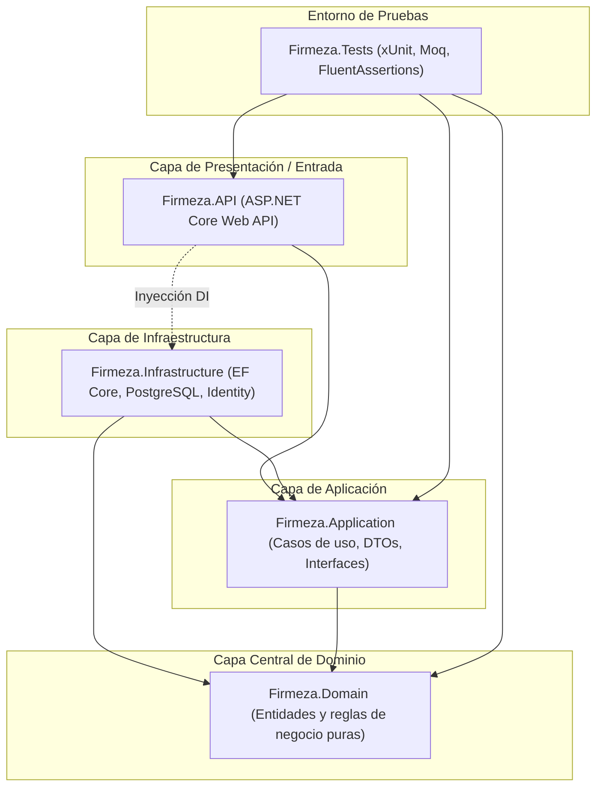

# Firmeza - Plataforma de Gestión Comercial y Ventas

Sistema integral de gestión comercial, catálogo de productos, registro de ventas y facturación desarrollado bajo los principios de **Arquitectura Limpia (Clean Architecture)** en **.NET 10 (C# 13)** y base de datos relacional en **PostgreSQL**.

---

## 🏛️ Arquitectura de la Solución

El proyecto implementa una arquitectura en capas concéntricas (Clean Architecture) garantizando la regla de dependencia hacia adentro:



### Estructura de Proyectos

* **`src/Firmeza.Domain`**: Núcleo del negocio. Contiene las entidades puras (POCOs) como `Cliente`, `Producto`, `Venta` y `DetalleVenta`, sin dependencias externas ni acoplamientos a frameworks.
* **`src/Firmeza.Application`**: Casos de uso de la aplicación, DTOs basados en `record` inmutables, reglas de validación e interfaces de servicios (`IClienteService`, `IProductoService`, `IVentaService`, `IJwtTokenService`).
* **`src/Firmeza.Infrastructure`**: Persistencia de datos con Entity Framework Core 10 y PostgreSQL (Npgsql), seguridad con ASP.NET Core Identity, tokens JWT y lógica de servicios con control transaccional de inventario y cálculo de IVA.
* **`src/Firmeza.API`**: Punto de entrada HTTP RESTful. Expone controladores protegidos con autorización basada en roles (JWT Bearer) y documentación interactiva OpenAPI / Swagger UI.
* **`tests/Firmeza.Tests`**: Pruebas unitarias automatizadas con **xUnit**, simulación de dependencias con **Moq** y aserciones expresivas con **FluentAssertions** (10/10 pruebas pasando).

---

## 🛠️ Stack Tecnológico

* **Lenguaje & Framework:** C# 13 / .NET 10.0
* **Acceso a Datos & ORM:** Entity Framework Core 10 + Npgsql (PostgreSQL)
* **Base de Datos:** PostgreSQL 14+
* **Seguridad & Autenticación:** ASP.NET Core Identity + Tokens JWT con roles jerárquicos
* **Pruebas:** xUnit, Moq, FluentAssertions
* **Documentación API:** OpenAPI / Swagger UI con soporte Bearer JWT
* **Procesamiento de Archivos (en roadmap):** EPPlus (Excel) e iTextSharp (PDF)
* **Frontend (en roadmap):** React 18+ (Vite), Axios, Tailwind CSS

---

## 📋 Estado del Plan de Trabajo (Roadmap)

| Historia de Usuario | Descripción | Estado |
| :--- | :--- | :---: |
| **US 1: Clean Architecture & xUnit** | Estructuración modular en capas concéntricas, Inyección de Dependencias desacoplada y suite xUnit con Moq y FluentAssertions (10 pruebas unitarias). | ✅ **Completado** |
| **US 2: Modelado DB-First en PostgreSQL** | Scripts DDL `database/schema.sql` y datos semilla `database/seed_data.sql` (clientes, productos, ventas, detalles, usuarios e Identity). | ✅ **Completado** |
| **US 3: API REST para Panel Administrativo** | Controladores RESTful para Auth, Productos, Clientes, Ventas (con cálculo de IVA 19% y control de stock) y Usuarios/Roles con Swagger y JWT Bearer. | ✅ **Completado** |
| **US 4: Procesamiento Excel y Generación PDF** | Carga masiva con EPPlus y facturación automática en PDF vía iTextSharp. | ⏳ *Pendiente* |
| **US 5: Módulo Frontend del Cliente (React)** | SPA con Vite + React, autenticación JWT, catálogo de productos y carrito de compras. | ⏳ *Pendiente* |

---

## 📡 Catálogo de Endpoints RESTful

### 🔐 Autenticación (`/api/Auth`)
* `POST /api/Auth/register`: Registro de nuevos usuarios con rol asignado.
* `POST /api/Auth/login`: Inicio de sesión y emisión de token JWT con tiempo de expiración y roles.

### 📦 Catálogo de Productos (`/api/Products`)
* `GET /api/Products`: Listado general de productos activos (Acceso público).
* `GET /api/Products/{id}`: Consulta de producto por identificador (Acceso público).
* `POST /api/Products`: Creación de un nuevo producto (*Requiere rol `Admin`*).
* `PUT /api/Products/{id}`: Actualización de producto (*Requiere rol `Admin`*).
* `DELETE /api/Products/{id}`: Eliminación de producto (*Requiere rol `Admin`*).

### 👥 Gestión de Clientes (`/api/Clients`)
* `GET /api/Clients`: Listado completo de clientes (*Requiere rol `Admin`*).
* `GET /api/Clients/{id}`: Consulta de cliente por ID (*Requiere rol `Admin`*).
* `POST /api/Clients`: Registro de nuevo cliente (*Requiere rol `Admin`*).
* `PUT /api/Clients/{id}`: Modificación de cliente (*Requiere rol `Admin`*).
* `DELETE /api/Clients/{id}`: Eliminación de cliente (*Requiere rol `Admin`*).

### 🧾 Gestión de Ventas (`/api/Sales`)
* `GET /api/Sales`: Listado de ventas registradas con cliente y detalles asociados (*Requiere autenticación*).
* `GET /api/Sales/{id}`: Consulta de venta por ID con su desglose financiero (*Requiere autenticación*).
* `GET /api/Sales/{id}/details`: Consulta exclusiva de los renglones/productos de una venta (*Requiere autenticación*).
* `POST /api/Sales`: Registro de nueva venta. Valida cliente activo, descuenta stock atómicamente y calcula IVA del 19% (*Requiere autenticación*).
* `PUT /api/Sales/{id}/cancel`: Anulación de comprobante y reincorporación automática del stock (*Requiere rol `Admin` o `Supervisor`*).

### 🛡️ Administración de Usuarios y Roles (`/api/Users`)
* `GET /api/Users`: Consulta de todos los usuarios registrados y sus roles en Identity (*Requiere rol `Admin`*).
* `GET /api/Users/roles`: Consulta de todos los roles configurados en el sistema (*Requiere rol `Admin`*).

---

## 🔑 Credenciales de Prueba por Defecto

Para pruebas locales desde Swagger o herramientas HTTP, se puede utilizar el usuario Administrador pre-cargado:

* **Usuario / Email:** `admin` o `admin@firmeza.com`
* **Contraseña:** `Admin123*`
* **Rol:** `Admin`

Otros usuarios disponibles para pruebas de roles: `vendedor1`, `cajero1`, `supervisor`, `gerente` (con su respectiva asignación).

---

## 🚀 Guía de Inicio Rápido

### Prerrequisitos
* [.NET 10 SDK](https://dotnet.microsoft.com/download)
* [PostgreSQL](https://www.postgresql.org/) (versión 14 o superior)
* [Node.js](https://nodejs.org/) (versión 18+ para futuro frontend)

### 1. Configuración de Base de Datos
1. Crear la base de datos en PostgreSQL:
   ```sql
   CREATE DATABASE firmeza_db;
   ```
2. Ejecutar los scripts ubicados en la carpeta `database/`:
   ```bash
   psql -U postgres -d firmeza_db -f database/schema.sql
   psql -U postgres -d firmeza_db -f database/seed_data.sql
   ```
3. Verificar la cadena de conexión en `src/Firmeza.API/appsettings.json`:
   ```json
   "ConnectionStrings": {
     "DefaultConnection": "Host=localhost;Database=firmeza_db;Username=postgres;Password=tu_password"
   }
   ```

### 2. Compilación y Pruebas Unitarias
```bash
# Compilar la solución completa
dotnet build

# Ejecutar la suite de pruebas unitarias (10 pruebas)
dotnet test
```

### 3. Iniciar la Web API y Swagger UI
```bash
dotnet run --project src/Firmeza.API --launch-profile http
```
* **URL Base:** `http://localhost:5125`
* **Swagger UI:** `http://localhost:5125/swagger`

---

## 🧪 Cómo autenticarse en Swagger UI

1. Ingresar a `http://localhost:5125/swagger`.
2. Ejecutar `POST /api/Auth/login` con:
   ```json
   {
     "emailOrUsername": "admin",
     "password": "Admin123*"
   }
   ```
3. Copiar el valor del campo `token` devuelto.
4. Hacer clic en el botón verde **Authorize 🔓** (arriba a la derecha).
5. Pegar el token directamente en el campo **Value** (sin anteponer la palabra `Bearer`).
6. Presionar **Authorize** y luego **Close**. Ahora todos los endpoints protegidos estarán habilitados para su ejecución.
